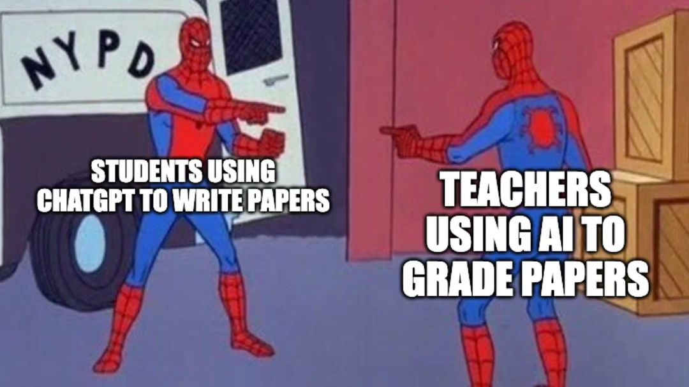

\#Как вы почувствовали, что мир поменялся и в вашу жизнь пришли LLM?

Несколько лет назад у меня появилась возможность попробовать себя в роли преподавателя.

Мой первый опыт преподавания был волшебным:

Мне оформили командировку, и я летел в предвкушении: несколько месяцев готовился, выстраивал почти идеальную программу моего учебного курса, продумывал каждую тему. Естественно не успел до начала. Вечерами я дописывал темы, готовился и репетировал, а на следующее утро встречался со студентами лицом к лицу, и как мог презентовал и увлекал их материалом. Это был последний год магистратуры, и моя цель была простой и честной — помочь студентам собрать достойный пет-проект, чтобы не утонуть при первом погружении в холодную воду рынка труда. Я чувствовал живой интерес. Я вернулся домой заряженным от студентов новой энергией.

Потом почему-то в университете финансирования на командировки не осталось. Следующий курс пришлось проводить онлайн, и он уже мало напоминал обучение. Я всё ещё читал лекции, вёл семинары, старался выложиться как прошлый раз, но уже явно чувствовал по обратной связи: студенты не воспринимают предмет всерьёз и, что хуже, не имеют желания. Оплата за курс, проведённый онлайн, оказалась заметно ниже. И зачёт в итоге свёлся к тестам.

Так вот, вернёмся к заявленной теме!

За год ДО появления всезнающих агентов я чувствовал по ответам на письменные вопросы и тесты напряжение студентов: кто-то старался разобраться, кто-то хитрил, кто-то пытался сорганизоваться и найти правильное решение, кто-то сдавался.

В год ПОСЛЕ появления всезнающих агентов -- ответы стали многословными и поверхностными, напряжение исчезло, никто даже не пытался прочитать вопрос сам.

Я сделал вид, что преподаю; студенты сделали вид, что учатся.

\#Мораль

Почему у студента нет времени и желания учиться?

Почему у профессора нет времени и желания преподавать?

Куда-то потерялся смысл во многих видах работы, и как бы нам его найти?

П.С.: Ради интереса я закинул этот текст в LLM и попросил его написать мораль, в целом он угадал.

