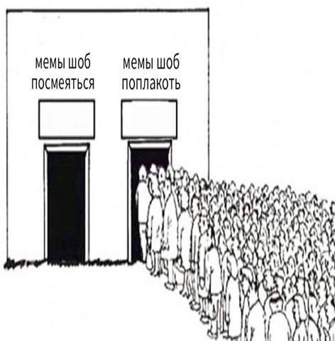

Зачем на документах добавлять лишние поля, кроме самых необходимых?

Чем больше полей — тем больше мест для ошибок, больше очередей.
Из-за любого незначительной мелочи приходится переподаваться и переполучать всё заново.

Получали ВНЖ Сербии. На карточках указаны: кроме фото, ФИО, даты рождения, срока действия и её номера, но ещё и гражданство, место рождения и прочая ерунда. В чипе закодирован адрес проживания и ещё много всякой чуши.

Зачем всё это на пластике?

Почему нельзя хранить эти данные на сервере, в БД, где их можно изменить? А запись легко получать по номеру карты. Номер уникальный, его достаточно, чтобы понять, что я — это я, и отличить меня от однофамильца и т. п.

Вы же всё равно будете проверять по БД. Как человек без интернета сможет убедиться, что у меня местом рождения указан Узбекистан?

Естественно, при выдаче ВНЖ жене в чип записали неверный адрес регистрации. А мне на карте — неверное место рождения. Жена отделалась перекодированием на месте. А мне пришлось перевыпускать карточку.

Ещё на карте ВНЖ Сербии указывают «основание», по которому оно было получено. И вы не поверите! В процессе жизни оно меняется. И угадайте что? В этом случае ВНЖ нужно получать заново! А значит, нужно встать в очередь, снова подать свои данные, заполнить заявление, откопировать кучу документов, принести их в полицию. Там инспекторы переложат эти документы, передадут другим, те вобьют данные из распечатанных документов в электронную БД, из которой мне распечатают талон ожидания. После чего будут думать, а я через неопределённое время приду получать точно такую же карточку, только теперь одно поле будет красивым и правильным!

Я не говорю, что государство не должно знать, где я живу. Я всё равно получаю отдельный документ о регистрации. И в моём профиле эти данные присутствуют. Я бы даже уведомлял о переезде через интернет, но это же не будет красиво напечатано на пластике, а значит, всё ерунда — никакого веса не имеет!

Тем временем делать эту «полезную» работу инспекторы не успевают, и собираются очереди на подачу, очереди на получение...

А ещё документы делают строго ограниченного срока действия, а не «до утраты законного основания для проживания в стране», и снова собираются очереди на переоформление карточек с теми же входными документами, по тем же основаниям.

При подаче на ПМЖ Сербии (это то же самое, что и ВНЖ, только называется по-другому, и карточка розовая, а не жёлтая) мне отказали, хотя у меня было действующее ВНЖ, по которому я мог жить в стране. Но «основание» у меня временно поменялось, и нельзя было просто изменить основание в строке БД и продолжить процедуру. Хотя карточку ВНЖ у меня должны были забрать, но не смогли, потому что на ней напечатано...

Мне пришлось стоять в длинных очередях: на отказ, на подачу, на рассмотрение, на дактилоскопию и на получение. Очереди длинные, потому что инспекторы не справляются с объёмом работы.

А ещё мы на днях получили ВНЖ Испании, в котором жене указали неправильный адрес регистрации, и этот адрес напечатан на карточке. Зачем? (Кроме того, до этого мы получили отдельные документы о месте проживания.) Вы не поверите, но люди иногда переезжают! И за время действия ВНЖ люди без собственной недвижимости в стране с большой вероятностью сменят место жительства. А что нужно будет сделать после переезда? Встать в очередь? И на какое время сейчас есть слоты на подачу документов? На полгода вперёд?

Потому что все заняты делом.

Другой пример. Во многих странах на автомобильных номерах указывают регион, в котором машина была зарегистрирована. Есть такой атавизм. Во-первых, в аналоговом мире, где нельзя пробить автомобиль по базе, можно сразу прикинуть, откуда этот водитель понаехал в нерезиновую, и разжечь яростный гнев между местными и колхозниками. Очень полезное разделение.

И когда ты переезжаешь из города в город — а такое тоже бывает, — нужно менять номера автомобиля вместе с адресом регистрации и данными в ВНЖ.

В Испании номера автомобилей не привязаны к регионам: там четыре случайные цифры и три случайные буквы. Купив автомобиль в Мадриде и поставив его на учёт в Бильбао, нужно только очно пройти техосмотр. В Европе пока не научились проводить полноценный техосмотр по трём фотографиям автомобиля, как в РФ. Есть куда расти.

Конец!

