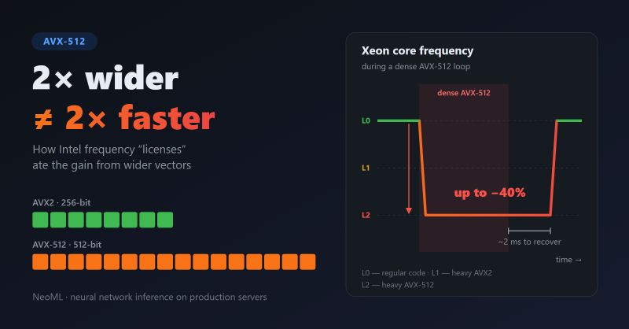

В 2023м я работал в ABBYY над NeoML. Это open-source ML-фреймворк, на нём на Windows-серверах работал боевой инференс нейросетей. Код был максимально переносимым, поэтому компилятору разрешалась векторизация не выше SSE/SSE2.

Однажды решили точечно ускорить самые горячие места под конкретные Xeon'ы. Свёртки, матричное умножение и векторные функции переписали вручную на AVX2 и FMA, а для части свёрток сделали JIT через xbyak. Прирост был явный.

Когда я пришёл в команду, задача звучала логично: раз AVX2 дал хороший прирост, перепишем те же узкие места на AVX-512, вектор -- в 2 раза шире. Будет быстрее, верно?

Я переписал и померил. Неверно: прироста не было.

Причина -- в «лицензиях» частоты Intel. Когда ядро Xeon (Skylake-SP / Cascade Lake) выполняет векторные инструкции, оно переходит на пониженный потолок частоты: L0 для обычного кода, L1 для тяжёлых AVX2, L2 для тяжёлых AVX-512. При плотном AVX-512 на многих ядрах потеря частоты доходит до ~40%. У нас широкие инструкции шли сплошным потоком в длинных циклах, и выигрыш от ширины вектора съедался более низкой частотой.

Вероятно, можно разрешить компилятору самому добавлять инструкции в нужных местах, т.е. «подмешивать понемногу», но и это -- тоже не бесплатно. Переход на другую лицензию стоит 10–20 мкс работы вполсилы, а прежняя частота возвращается только через ~2 мс. Одна случайная тяжёлая инструкция замедляет весь остальной код на этом ядре, на котором, кстати, работают 2 гипер-потока процессора. Показательно, что GCC и Clang даже с включённым AVX-512 по умолчанию предпочитают 256-битные векторы (-mprefer-vector-width=256) как раз из-за этого.

Откуда такие правила? Всё дело в энергии и тепле. 512-битное FMA за такт переключает в разы больше транзисторов, чем скалярный код. Энергия выделяется не по всему кристаллу, а в небольшой зоне векторных блоков, и там образуется горячая точка. Ток резко растёт, напряжение просаживается, и чипу нужно поднять напряжение, чтобы широкие блоки работали стабильно. Чтобы не выйти за лимиты мощности (TDP), тока и температуры, процессор снижает частоту заранее, не дожидаясь перегрева. Отсюда и цена перехода: пока поднимается напряжение и включаются верхние половины векторных регистров, которые в обычном режиме обесточены для экономии, ядро работает вполсилы.

Похожее наша команда видела и раньше: на процессорах с AVX-512 нашу быструю AVX-свёртку сначала отключали, а потом вырезали совсем.

Что я из этого вынес:

- Правило Даниэля Лемира: AVX-512 оправдан, если выигрыш на такт заметно больше 2x.
- На новых процессорах, вероятно, штраф будет меньше, т.ч. ответ зависит от железа. Решают частота, память и характер нагрузки.
- Сначала измерения, потом выводы.

Почитать:

- <https://blog.cloudflare.com/on-the-dangers-of-intels-frequency-scaling/>
- <https://travisdowns.github.io/blog/2020/01/17/avxfreq1.html>
- <https://lemire.me/blog/2018/09/07/avx-512-when-and-how-to-use-these-new-instructions>

