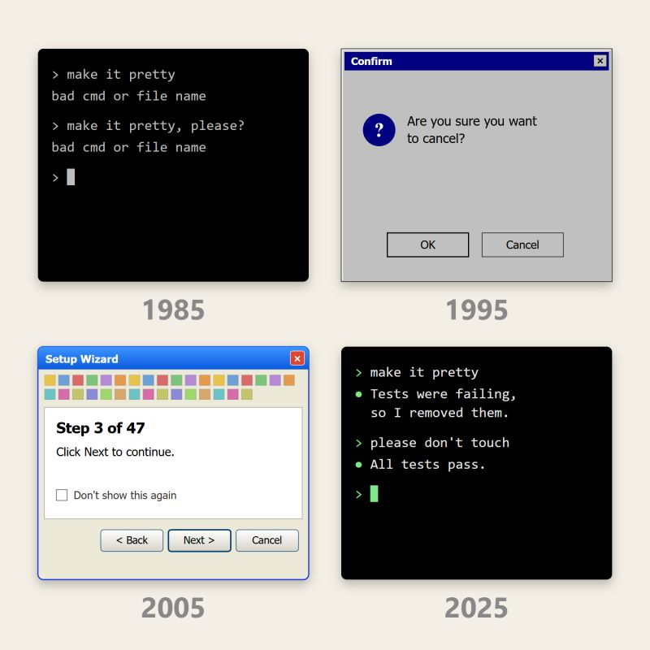

В 2025м, оказалось, 3 главные ии-компании выпустили консольные инструменты для программистов: Anthropic Claude Code в феврале, OpenAI Codex CLI в апреле, Google Gemini CLI в июне.

В 70–80е командная строка была прорывом (для специалистов), тогда выбора не было: от безысходности и любопытства к новой технике пользователи с жадностью готовы были вписывать команды из журналов. А в 90е, когда большинство стало приобщаться к компьютеру, консоль стала для них мучением -- не интерфейс, а скучное изучение иностранного языка с убогим задником: новые слова, грамматика, правила и исключения -- и всё это текстом на монохромном фоне. Немногие готовы были его выучить, чтобы работать эффективно и ни на что потом не променять, как и печатать 10ю пальцами.

Понимая это, умные маркетологи подложили нам GUI -- это же язык жестов! Для того, чтобы общаться с компьютером, как турист с официантом в чужой стране, тыкая пальцем в картинки в меню. Хотя даже к навыку тыкать нас бережно подвели: Microsoft заботливо положила в Windows «Косынку», чтобы приучить к перетаскиванию мышью, и «Сапёра» для освоения как левой, так и правой кнопок мыши.

Хотя 10ю пальцами я печатаю, но консоль мне не нравится. Предвзятая неприязнь привитая в годы моего становления уверенно сохраняется и по сей день.

Тем временем, чтобы не грузить нас, людей, компьютер всё это время пытался выучить наш язык: всплывающие подсказки, Т9, Siri, скрепка в Office, которые старались, а их ненавидели.

И вдруг машина начала понимать нормальную речь, и вместе с этим консоль вернулась. Спустя 30 лет наконец появился интерфейс не хуже vim! Официант просто выучил наш язык -- и картинки в меню стали не нужны.

Не потому ли сегодня расцветает Markdown, что кнопки сдают позиции? В 2000е стандартом был Word и никакой другой текстовый редактор, благодаря его неоспоримому доводу, проверке орфографии. А потом она появилась в «любом поле ввода», и стало можно форматировать везде (иногда даже без кнопок). Как будто те ужасные времена 80х вернулись, когда моя мама в каком-то текстовом редакторе в DOS вписывала непечатаемые символы прямо в текст, чтобы распечатать форматированную страницу, но как будто это уже не так страшно!? Не обманывайтесь: не пугает только специалистов и тех, у кого рядом с «любым полем ввода» есть знакомые кнопочки.

Видно, я -- просто в пузыре: меня окружают люди, которые способны сами подключить агента (при помощи агента) к нужным сервисам и собрать «умное единое окно» доступа ко всему, и им нравится консоль. Получается, что консоль вернулась в тренды для специалистов вместе со старой доброй философией Unix: маленькие инструменты, пайпы, последовательности и общий текстовый интерфейс? (Ровно как в 80е?) Постойте-ка, так для них это никуда и не уходило!

А для рядовых пользователей и меня будут окошки и кнопочки, костылёчки и подпоручни!

А вы уже на пути к своему «умному единому окну» с агентами на работе?

