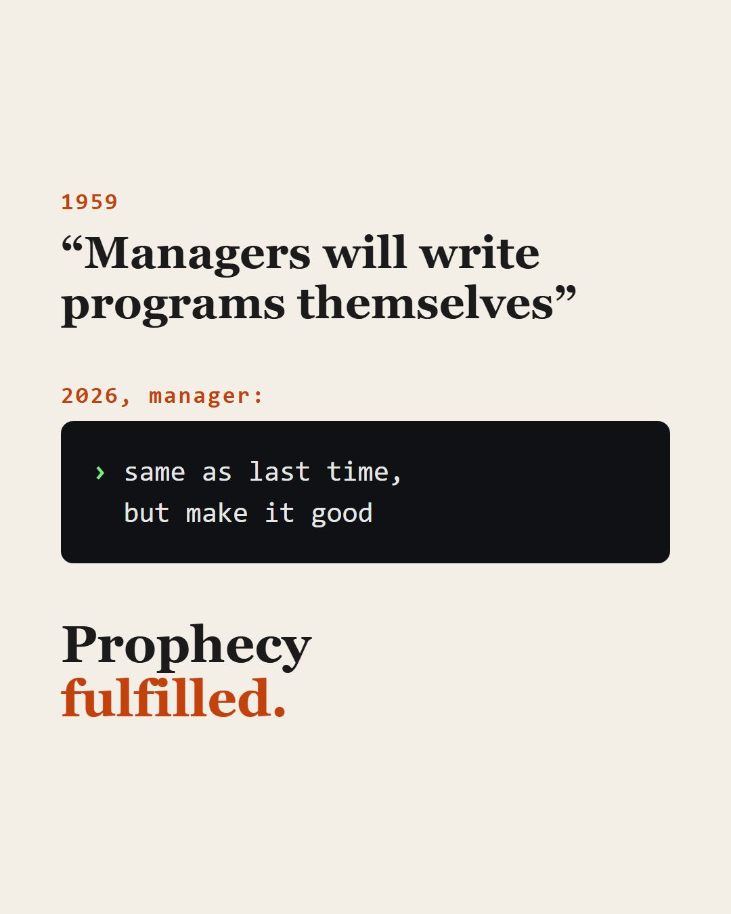

Больше 10 лет прошло, как я защитил свой диплом бакалавра. Тогда я мечтал написать что-то приближённое к самомодифицирующемуся коду. Конечно, получилось гораздо скромнее: интерпретируемый язык #IPL, синтаксис которого "похож" на формализованный текст естественного языка, и программы, на котором он мог "переводить" на разные языки. Исходный код на практике (тогда) мог быть понят только специалистом, хотелось приблизить программирование к людям.

Жаль я не знал в свои бакалаврские годы, что «это уже обещали в 1959-м», иронично!

«COBOL (1959) продвигали как язык, на котором бизнес-менеджеры будут писать сами: ADD TAX TO PRICE GIVING TOTAL». В итоге на нём писали всё те же программисты, просто многословнее.

Потом «аналитики будут писать SQL-запросы сами» (а сегодня, кстати, это реальность при помощи ии).

«Будущее за no-code-платформами!»

Тогда не получилось, потому что естественный язык неоднозначен, а компилятор требует точности.

Сегодня я открываю терминал, пишу ИИ-агенту на своём обычном языке, что нужно сделать, и он делает, исправляя в пути ошибки. Это и перевод с естественного языка на формальный, и код, который меняется в ответ на результат. Задача, которую я едва начал в дипломе, сейчас решается в повседневной жизни! Наконец, появился «компилятор», который может переспросить, понимает контекст и спокойно работает с неоднозначностью.

Моё спекулятивное предположение (тогда, но в него я верю сейчас только сильнее): естественный язык должен стать основным языком программирования. Формальные языки программирования уйдут в прошлое, как ушли машинные коды и ассемблер.

Агент меня поправляет - «не исчезнут, а уйдут вниз по стеку», утверждая, что на нём люди пишут драйверы, загрузчики и горячие циклы; просто большинство его не видит. А я согласен -- формальные языки (некоторые) (пока) ещё наблюдают при отладке и ревью.  😅

**Магистерская: научная новизна, которой осталось на неделю**

Моя магистерская #RobotHand была про обучение робота действовать своим железным телом правильно, решая поставленные цели, без знания о собственной структуре и возможностях, путём проб и ошибок, как младенец в первые дни.

У этой работы ещё осталась толика новизны. Но, честно говоря, довести её до ума вместе с Claude, по моим ощущениям, можно примерно за неделю.

Удивительно, что за столь короткий срок я застал такой космический рост эффективности инструментов!

А у вас есть студенческая работа, которая за пару лет превратилась из науки в рутину?

Репозитории:

- \#IPL — [GitHub: favorart/IPL — Interpreted Programming Language](https://github.com/favorart/IPL)
- \#RobotHand — [GitHub: favorart/robot-hand — Emulator Robot Hand WindowsApp](https://github.com/favorart/robot-hand)

