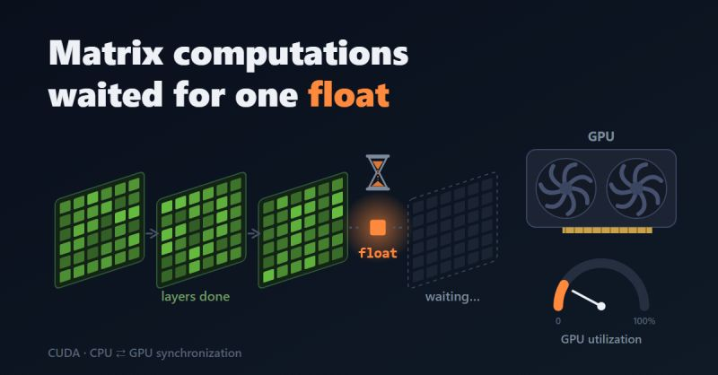

Как 1 float обучение на видеокарте может тормозить?

Мощную видеокарту ставят в сервер, чтобы матрицы, свёртки и градиенты летали. Обидно, когда вычисления в огромных матрицах стоят и ждут. Эту проблему я чинил в NeoML, открытой ML-библиотеке ABBYY (о ней был [прошлый пост](/writing/avx512-frequency/)).

Видеокарта -- это отдельный мини-компьютер со своей памятью, и RAM-память программы она не видит: всё нужное для счёта ей привозят по шине.

При обучении нейросетей процессор сам почти не считает -- он ставит видеокарте задачи в очередь. Поставил за пару микросекунд и побежал дальше, результата не ждёт. GPU выполняет задачи строго по порядку. Если одна пишет результат в память карты, а следующая его читает, ждать нечего: к её старту данные на месте. В здоровой программе CPU убегает далеко вперёд, а очередь задач видеокарты не пустеет.

Теперь пусть задаче нужно число от CPU, всего 4 байта. Скорость шины тут ни при чём: по ней они пролетают мгновенно. Дорог сам рейс.

Базовая функция копирования в CUDA, cudaMemcpy, синхронная: сначала ждёт, пока GPU выполнит всё поставленное раньше, и только потом копирует. Порядок важен: ячейку на карте ещё могут читать задачи из очереди, и им нужно старое значение.

Потом пересадка. Байты по шине возит отдельный блок видеокарты, DMA. Забирать их он умеет только из закреплённой RAM-памяти -- той, которую ОС не выгрузит на диск и не передвинет. Поэтому драйвер перекладывает число в свой закреплённый буфер, и лишь оттуда оно едет на карту.

Итого: CPU стоит, пока GPU доделает очередь, потом 2 пересылки, потом GPU стоит пустой, пока CPU заново наполняет очередь. У NVIDIA есть замер: задача считается 2,9 мкс. Если CPU не ждёт, выходит 3,8 мкс на задачу. Если ждёт после каждой -- 9,6. В 2,5 раза медленнее, и это ещё без копирования.

Не ждать можно: cudaMemcpyAsync ставит копирование в очередь как ещё одну задачу. Но тогда число обязано лежать в закреплённой RAM-памяти и не меняться, пока очередь до него не дойдёт. Выделять такую память долго, и отнимается она у ОС, так что свежий буфер на каждое число не возьмёшь. Нужен пул ячеек и учёт, какую из них GPU уже прочитал. Целая подсистема ради 4 байт.

В NeoML её не было. Почти все методы принимали скаляры адресом в памяти карты, а клал их туда cudaMemcpy. Машинное эпсилон в функции потерь, порог ReLU в блоках MobileNet, границы градиента в оптимизаторе, да любой коэффициент -- ехали на карту с полной остановкой конвейера. На каждом шаге обучения.

Нашёлся обходной путь: аргументы задачи передаются по значению, внутри команды запуска. Число вписывается в команду в момент постановки -- ни буфера, ни рейса. Откуда бы ни пришёл коэффициент -- из памяти программы по значению или из памяти видеокарты по адресу, -- к старту задачи он известен. Остановок нет ни в каком случае.

[PR](https://github.com/neoml-lib/neoml/pull/1070), который помогает видеокарте не ждать, с 2024 года сам ждёт своего часа.

А вам приходилось искать, чего ждёт ваш код?

\#CUDA #GPU #ML #performance

Почитать:

* NVIDIA, CUDA Runtime API: API synchronization behavior -- какое копирование ждёт очередь, а какое нет https://docs.nvidia.com/cuda/cuda-runtime-api/api-sync-behavior.html
* NVIDIA, How to Optimize Data Transfers in CUDA C/C++ -- закреплённая память и цена мелких пересылок https://developer.nvidia.com/blog/how-optimize-data-transfers-cuda-cc/
* NVIDIA, Getting Started with CUDA Graphs -- откуда цифры 2,9 / 3,8 / 9,6 мкс https://developer.nvidia.com/blog/cuda-graphs/
* PyTorch Performance Tuning Guide https://pytorch.org/tutorials/recipes/recipes/tuning_guide.html

