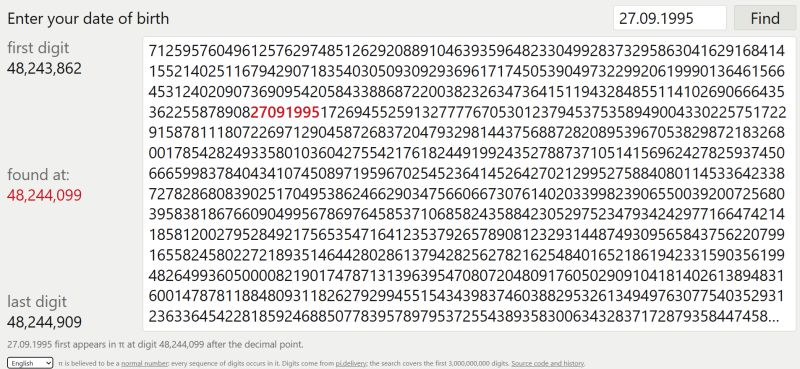

Я посчитал три миллиарда знаков π: все до одной даты календаря прячутся внутри.

С какой по счёту цифры начинается ваш день рождения -- узнать можно [на сайте](https://favorart.github.io/pi-birthday/).

В числе π, скорее всего, записана любая конечная цепочка цифр. Пока это только математическая гипотеза.

Но как пощупать эту гипотезу своими руками? Я выложил сайт, чтобы каждый мог это сделать. Пока его делал, встретил много технических проблем. Они показались мне настолько интересными, что я написал детективную статью.

Последовательности из 8 цифр ДДММГГГГ попадаются в среднем раз на 100 миллионов знаков. Сколько знаков нужно, чтобы нашлась каждая из 3,65 млн дат календаря? Почему перевод большого числа в строку в CPython признали уязвимостью? Как numpy прошёл 1,7 млрд цифр за полторы минуты? Когда родился Иисус и зачем понадобился нулевой год?

[Полная статья](/writing/pi-stores-everything/)

Какую дату вы бы проверили на сайте первой?

\#Python #Math #Algorithms #numpy #Pi

