-- насмешливо спросила жена.

Ответа у меня не было. Были файл с резюме на YAML, профиль в LinkedIn и смутное хочу красивое, а не сделанное на коленке. Через два вечера сайт был готов, и ответ -- тоже.

## Я не знал, чего хочу

Я пришёл к Claude без техзадания. Было только представление о сайте: тёплый и современный, с солнечным акцентом.

Claude задавал вопросы, а потом предлагал варианты: три макета сайта, абзац описания у каждого. В одном мне понравились раскладка и навигация, в другом стиль, в третьем анимация. Я выбрал пастельный фон и скруглённые углы, мягкое солнечное настроение, меню на каждой странице и заметное увеличение картинок при наведении мыши.

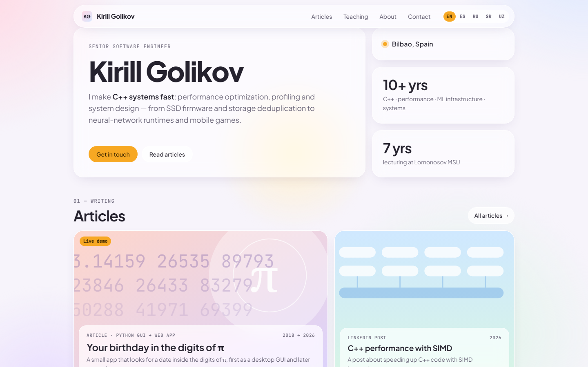

Солнце в центре осталось не случайно. Двадцать шесть веков назад персидский царь Куруш собрал самую большую империю, какую тогда видел мир. Греки звали его Кюрос, Кир, и на слух это почти совпадало с их словом «кюриос», господин. Царю подходило. А через шестьсот с лишним лет Плутарх записал, что Кира назвали в честь солнца, ведь персы так солнце и зовут. Лингвисты Плутарху не верят. А мне он нравится: я царю почти тёзка. Так что в центре сайта свечу я сам.

## Как выглядит стекло?

Сначала Claude мне предложил то, что предлагает обычно: строгий минимализм, тёмный инженерный стиль под терминал и журнальную вёрстку с крупными заголовками. А я хотел сайт, который не выдаёт мой нейрослоп. Заглянул вглубь себя и изрёк: стекло, современные поверхности, полупрозрачные и матовые, с бликом.

Дальше мы долго мучились с эффектами и фонами. Солнце то слепило и давило на всё вокруг, то пропадало совсем.

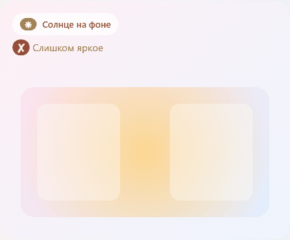

Отклик на мышь тоже сложился не сразу. Я хотел тот самый наезд на картинку из третьего макета.

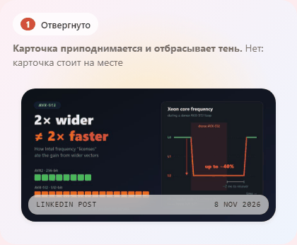

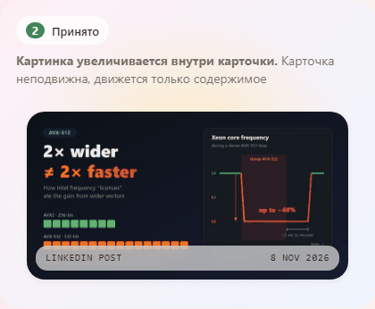

Наезд выбрали, но я его не видел и дважды жаловался, что увеличения у меня просто нет. Claude дважды проверял стили, и всё было на месте. Оказалось, у меня в Windows выключены эффекты анимации. Браузер честно передавал сайту просьбу обойтись без движения, и сайт честно не двигался. Мой же Windows запрещал показывать мне то, что я заказывал. Теперь для таких, как я, есть тихая версия, где картинка увеличивается чуть-чуть и быстро.

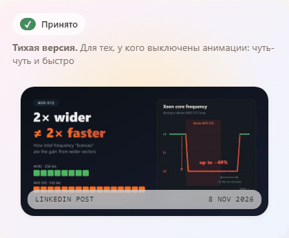

Дольше всего не давалось само стекло.

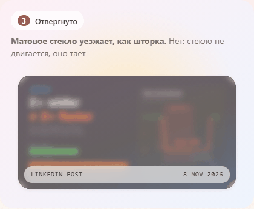

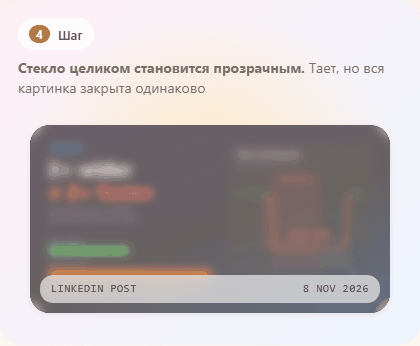

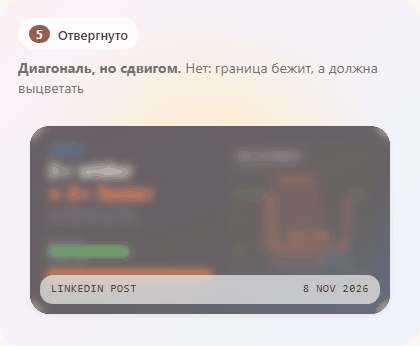

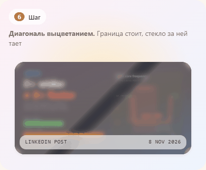

Где пройдёт диагональ и насколько она размыта, словами не объяснить. Поэтому Claude сделал отдельную страницу-стенд, где девять вариантов двигаются одновременно. Они закрывают 30, 20 или 10 процентов картинки, а граница у них резкая, средняя или широкая. Смотришь и тычешь пальцем в нужный.

Я выбрал. А потом понял, что всё это время хотел наоборот.

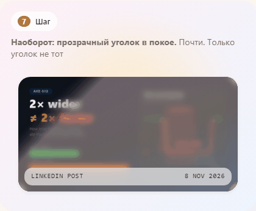

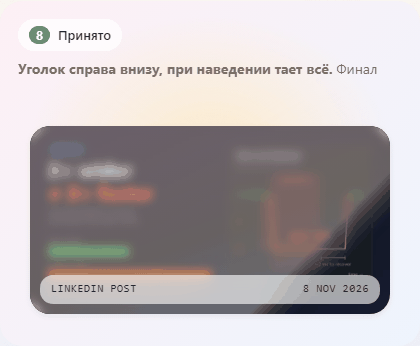

## От ссылок до кнопок

Как выделять ссылки, тоже решили только с третьей попытки.

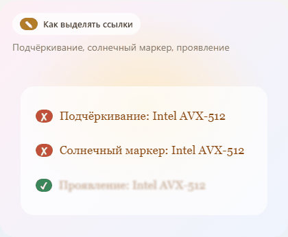

Иконка на вкладке -- весь сайт в маленьком квадратике, с тем самым солнцем. Теперь солнце встречает нас и на фоне, и на вкладке, и в логотипе страницы.

Кнопка под разделом на главной сначала говорила просто «All writing» и пряталась маленькой в углу. Было непонятно, что за ней скрывается ещё много всего. Теперь она ярко зовёт внутрь и пишет «All 12 articles», по настоящему их числу.

Под каждой статьёй две одинаковые кнопки, но яркая только «Send feedback». Она призывает того, кто дочитал до конца и почти решился написать. Дорогу назад к списку он найдёт и сам.

## Что сделано под капотом? Самому интересно!

Статьи из моих репозиториев на сайт не копируются. Поправил README в репозитории, и поправилась страница. Второй версии нет, так что и расходиться нечему.

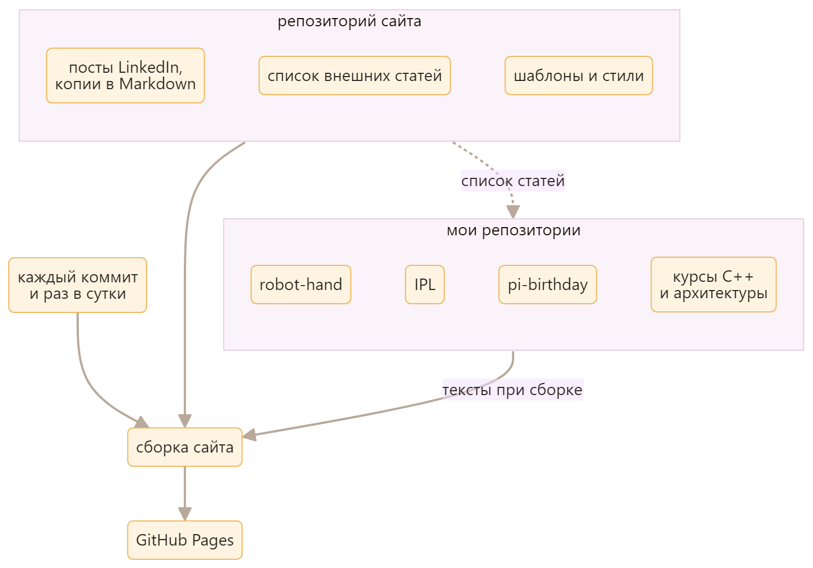

Сайт говорит на английском, испанском, русском, сербском и узбекском. Кто читал моё резюме, узнает в этом наборе карту.

## Head of Slop Review

Под моим именем на главной по очереди сменяются шуточные роли. Одну я честно утащил у коллеги: начальник отдела проверки нейрослопа. Она и описывает мою работу точнее всего.

Подпись внизу каждой страницы Claude сочинил сам: сайт сделал Claude, пока человек подбирал пастельные цвета. Я вычеркнул из неё одно слово, и это, пожалуй, мой самый большой вклад в тексты сайта.

Сто мелких «нет» -- и получился сайт, которым я доволен. Каждое уточняло что-то не столько в сайте, сколько во мне. Чего я хочу, я узнавал, отвергая.

Мелочи вроде оттенка солнца или прозрачности панелей я видел, просто обновив страницу: новая версия выкладывается сама через минуту-другую. Для крупных решений Claude собирал стенды, где все варианты видны сразу. Это и восхищает больше всего. Ощущение превращается в вариант, вариант -- в решение, и вот это решение уже работает на сайте.

## Так зачем мне сайт?

Пока я его делал, я понял, сколько мне есть что сказать.

Статьи, которые годами лежали по разным репозиториям. Посты, которые жили в LinkedIn за стеной логина. Закладки «потом дочитаю», ссылки «надо бы оформить», недодуманные мысли. Сайт заставил разложить всё это по полкам. Что-то легло на страницу. Что-то я наконец выбросил. Давно открытые вопросы закрылись.

Сайт оказался не витриной, а уборкой в голове.

Я очень вдохновлён! I'm excited, ¡estoy emocionado! Я как ребёнок с новой игрушкой. Если бы у меня была такая в детстве, я бы вообще никогда и ни за что не вышел из дому!
