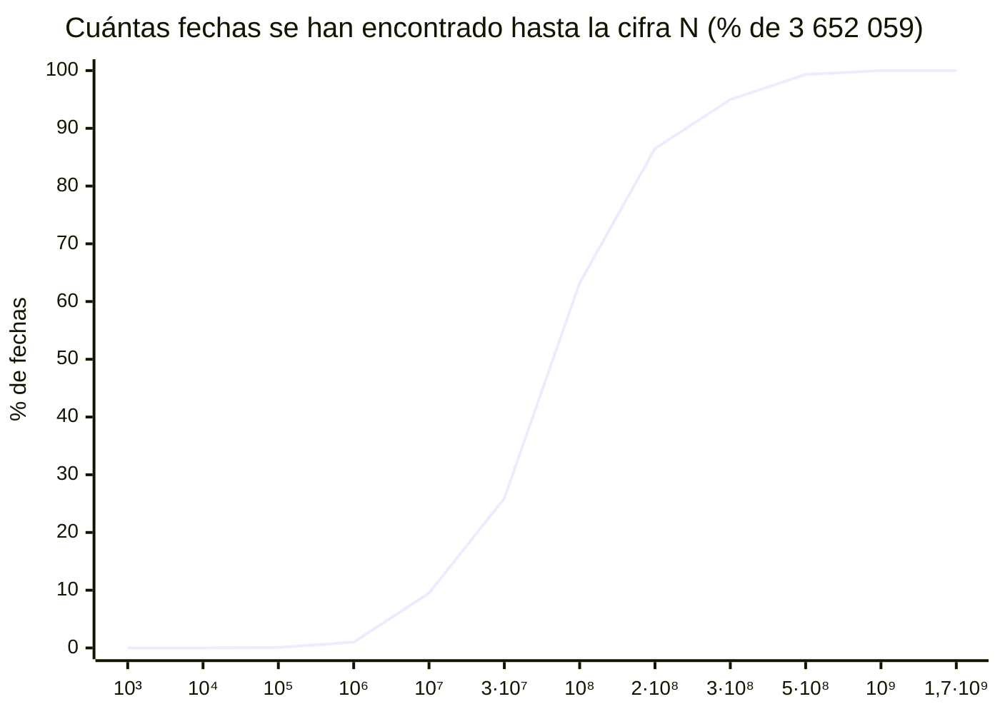
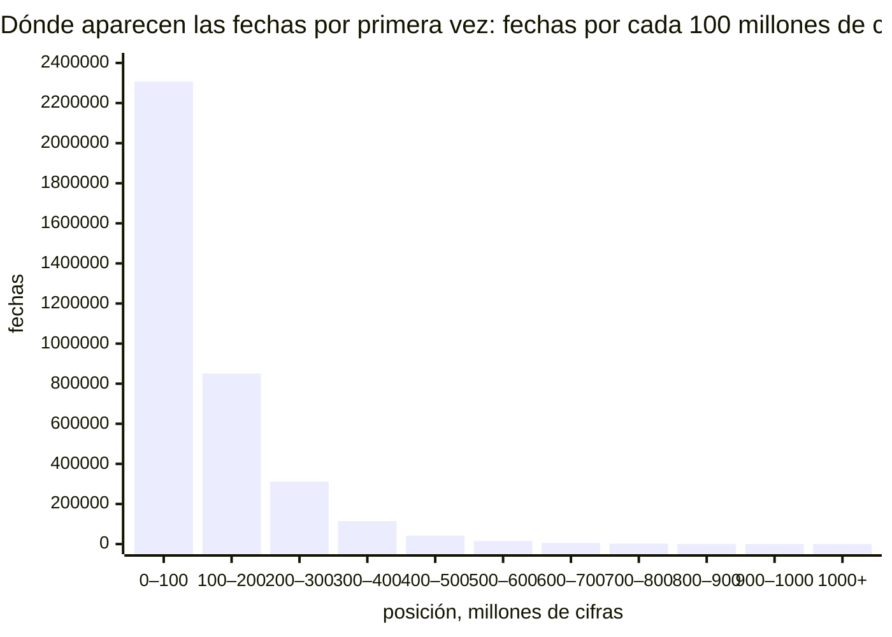
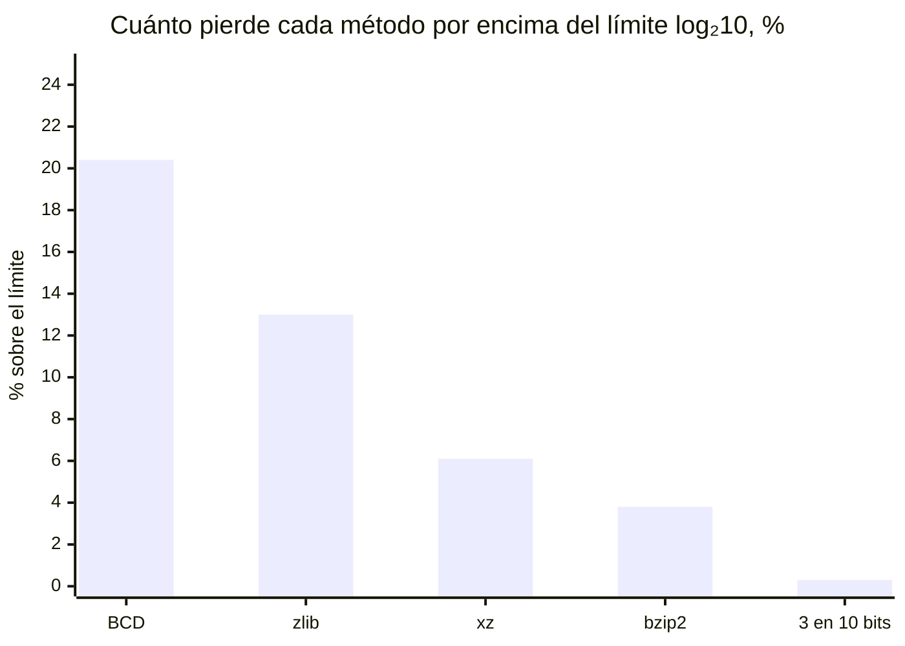
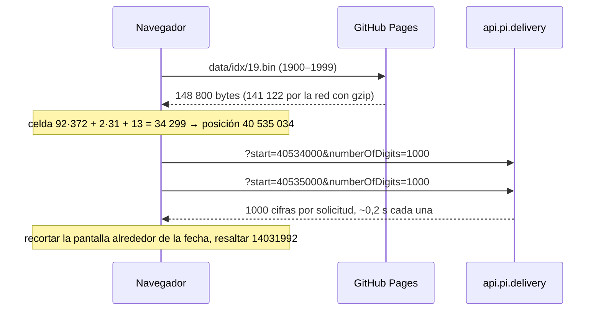
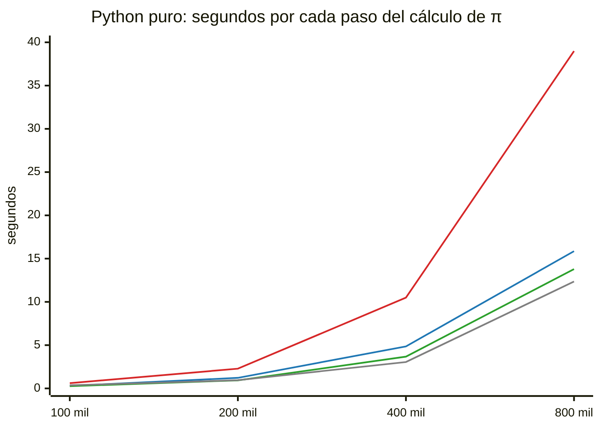
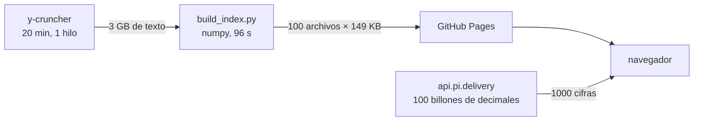

# π lo guarda todo, así que no tuve que guardar π

_¿Es verdad que entre las infinitas cifras del número π está escrita cualquier cadena de cifras?_\
_¿Y, por lo tanto, también cualquier fecha del calendario?_\
_¿Qué fecha aparece en π antes que todas y cuál se esconde más hondo?_\
_¿Y cómo encontrar su fecha de nacimiento sin guardar ni una sola cifra de π?_

~~Con mediciones y gráficos.~~ Con dibujitos, para los más pequeños.

[English](article-2026.md){: hreflang=en } · [Русский](article-2026.ru.md){: hreflang=ru }

---

## ¿Es verdad que en π está todo?

El número [π](https://es.wikipedia.org/wiki/Número_π) es la razón entre la longitud de una circunferencia y su diámetro, 3,14159265… Sus cifras decimales no se acaban y nunca entran en un ciclo. Ya lo demostró [Lambert](https://es.wikipedia.org/wiki/Johann_Heinrich_Lambert) en 1761: π es un [número irracional](https://es.wikipedia.org/wiki/Número_irracional).

Los matemáticos creen que π es un [número normal](https://es.wikipedia.org/wiki/Número_normal). Eso significa que cada cifra aparece en su escritura una de cada diez veces, cada par de cifras una de cada cien, cada grupo de ocho cifras una de cada cien millones. ¡Como si alguien hubiera sacado las cifras de π tirando un dado honesto de diez caras!

Si es así, en π está escrita cualquier cadena finita de cifras. Su número de teléfono. El número de su tarjeta de crédito. El texto de esta nota en cualquier codificación. Una auténtica [Biblioteca de Babel](https://es.wikipedia.org/wiki/La_biblioteca_de_Babel) de Borges, solo que infinita.

Pero la normalidad de π es, por ahora, solo una conjetura. Las comprobaciones con billones de cifras coinciden con ella, pero no hay demostración. ¡Ni siquiera está demostrado que el siete aparezca en π infinitas veces!

## No se puede demostrar. ¿Y cómo se puede sentir?

Cualquier fecha se puede escribir con ocho cifras seguidas. Mi cumpleaños cae en el [Día de π](https://es.wikipedia.org/wiki/Día_de_π), y el 14.03.1992 se convierte en `14031992`. Cada cifra aparece en π una vez cada diez decimales, cada par una vez cada cien y cada grupo de ocho cifras una vez cada cien millones. Así que también su fecha aparece en π más o menos una vez cada cien millones de decimales. Si se imprimen cien millones de cifras, salen cien tomos de 330 páginas. Una pared de libros, ¡y su cumpleaños está en algún lugar de ella!

Abran https://favorart.github.io/pi-birthday/, introduzcan su fecha de nacimiento y pulsen «Buscar». En medio de una pared de cifras se iluminará en rojo su cumpleaños, y a la izquierda, el número de posición. El mío apareció en la cifra 40 535 034 después de la coma:

Y ahora muéstrenselo a un niño: a partir de ahí, las preguntas las hará él solo. ¿Y la fecha de mamá? ¿Y la de papá? ¿Hay alguna fecha que no esté en π? (Spoiler: no la hay). ¿Y cuál está escondida más hondo?

## ¿Cuántas cifras de π hacen falta en realidad?

Fechas del 01.01.0001 al 31.12.9999 hay **3 652 059**, y cada una hay que esperarla, en promedio, cien millones de cifras. Pero aquí ese «en promedio» engaña.

Así se van reuniendo las fechas mientras avanzamos por π. Los pasos del eje no son iguales, y lo principal es el centro: hacia los 69 millones de cifras (10⁸ · ln 2) se ha encontrado la mitad de las fechas; hacia 10⁸, el 63 %; hacia los quinientos millones, el 99,3 %. El último 0,7 % se estira a lo largo de más de mil millones de cifras adicionales.

_La línea coincide con la fórmula 1 − e^(−N/10⁸)._

No nos interesa el promedio, sino la **más tardía** de los 3,65 millones de fechas: es ella la que decide cuántas cifras hay que calcular.

Se puede estimar con un razonamiento sencillo. Avancemos por las cifras de π y vayamos atrapando fechas. Mientras no hayamos atrapado ninguna, hay N = 3 652 059 trampas, y la primera fecha cae casi enseguida: en promedio, al cabo de 10⁸ / N cifras. Después queda una trampa menos, y la siguiente fecha tarda un poco más. Y así hasta la última, que cae sola y espera los 10⁸ completos. Sumamos las esperas: 10⁸ · (1/N + 1/(N−1) + … + 1/2 + 1).

La suma entre paréntesis es el [número armónico](https://es.wikipedia.org/wiki/Número_armónico) H_N. Para N grandes es casi igual a ln N + 0,577, donde 0,577 es la [constante de Euler](https://es.wikipedia.org/wiki/Constante_de_Euler-Mascheroni). Para nuestras fechas da 15,69, así que la última fecha habrá que esperarla unas 10⁸ · 15,69 ≈ **1570 millones de cifras**. Es una estimación en promedio: en la práctica, la última fecha puede aparecer antes o después. Es el [problema del coleccionista de cupones](https://es.wikipedia.org/wiki/Problema_del_coleccionista_de_cupones), como con las estampitas que venían con los chicles: las primeras salen a montones y la última es la que más se hace esperar.

La cola se ve si contamos cuántas fechas aparecen por primera vez en cada tramo de cien millones de cifras:

En la primera barra está más de la mitad de todas las fechas, 2,3 millones de 3,65, y cada barra siguiente es casi exactamente e ≈ 2,7 veces más baja que la anterior: así se ve una [distribución exponencial](https://es.wikipedia.org/wiki/Distribución_exponencial). A la derecha, una cola larga: más allá de los mil millones están las 154 fechas con peor suerte.

## ¿Y cómo funciona esto?

En 2018 [mi programa](/es/writing/pi-birthday/) (sin internet) necesitaba un archivo de texto de 3 GB: tres mil millones de cifras de π, un byte por cifra, calculadas «por si acaso», casi el doble de las necesarias. Y además una tabla «fecha → posición» de 3,65 millones de filas que Python tardaba ¡4 segundos en leer!

Ahora quise que los lectores de la nota pudieran hacer el mismo experimento por su cuenta y me propuse convertir aquel viejo programita en una página web en GitHub Pages. Solo que GitHub [no acepta archivos de más de 100 MB](https://docs.github.com/en/repositories/working-with-files/managing-large-files/about-large-files-on-github){: hreflang=en }, y mi archivo era treinta veces más grande. Buscar una salida me entusiasmó tanto que de ahí salió una nota nueva. ¡Porque al final el sitio no necesitaba el archivo de cifras para nada! ¿Cómo pasó eso?

## 1. ¿Y si π se puede comprimir?

Primera idea: 3 GB de texto hecho solo de cifras seguro que se comprimen. Comprimí los primeros 10 millones de decimales y multipliqué el resultado por 300, porque con cifras aleatorias la tasa de compresión no depende de la longitud:

| Método | 3000 millones de cifras | Bits por cifra | Acceso directo a la cifra N |
|---|---|---|---|
| Texto ASCII | 3,00 GB | 8 | sí |
| zlib -9 | 1,41 GB | 3,75 | no |
| bzip2 -9 | 1,29 GB | 3,45 | no |
| xz (lzma -9) | 1,32 GB | 3,52 | no |
| 2 cifras por byte ([BCD](https://es.wikipedia.org/wiki/Decimal_codificado_en_binario)) | 1,50 GB | 4 | sí |
| 3 cifras en 10 bits | 1,250 GB | 3,33 | sí |
| Límite teórico | 1,246 GB | log₂10 ≈ 3,32 | — |

¿De dónde sale el límite? Una cifra es una elección entre diez opciones igual de probables. Tres bits alcanzan solo para 8 opciones; cuatro bits dan 16, y seis de ellas se desperdician. Exactamente diez opciones son log₂10 ≈ 3,32 bits, porque 2^3,32 ≈ 10. Si las cifras son aleatorias, en promedio no se puede bajar de ahí: es la [entropía](https://es.wikipedia.org/wiki/Entropía_(información)) de Shannon.

Por eso el gráfico no muestra los bits en sí, sino cuánto pierde cada método por encima del límite. ASCII no cabría: +141 %. Los compresores pierden entre un 4 y un 13 %, y el burdo empaquetado «tres cifras en 10 bits», solo un 0,3 %:

Los compresores buscan repeticiones, y en π no las hay. Cada cifra aparece casi exactamente en el 10 % de los casos (entre 999 333 y 1 001 093 veces cada 10 millones), y la siguiente no depende de las anteriores. Al compresor solo le queda tirar los bits sobrantes del código ASCII. Eso también lo consigue el empaquetado «tres cifras en 10 bits» (1000 opciones de 1024), y además mejor, más rápido y sin perder el acceso directo: la dirección de la cifra N se calcula con una fórmula.

Conclusión: ningún compresor dejará 3000 millones de decimales por debajo de **1,25 GB**. Y GitHub Pages tiene un [límite](https://docs.github.com/en/pages/getting-started-with-github-pages/github-pages-limits){: hreflang=en } de 1 GB para todo el sitio. Callejón sin salida.

## 2. ¿Y si guardamos solo lo que se ve en pantalla?

En la pantalla, de todos modos, no caben 3000 millones de cifras. Abrí una captura del programa de 2018 y conté: 11 líneas de 42 cifras. En total, unas **460 cifras** por pantalla, de las cuales 8 son la propia fecha, que no hace falta guardar.

Entonces, para cada fecha se puede guardar una ventana de unas 450 cifras a su alrededor. Empaquetamos las cifras de tres en tres en 10 bits y añadimos 4 bytes para la posición:

| Ventana alrededor de la fecha | Cifras por fecha | Total para 3,65 millones de fechas |
|---|---|---|
| ±20 | 40 | 76 MB |
| ±50 | 100 | 167 MB |
| ±100 | 200 | 319 MB |
| pantalla de 2018 | ~450 | **~700 MB** |
| ±400 | 800 | 1,23 GB |
| pantalla, fecha en cualquier lugar | 904 | 1,39 GB |
| ±500 | 1000 | 1,54 GB |

La pantalla de 2018 cabe, pero muy justa, y cada actualización del sitio se convierte en subir cientos de megabytes. Y si la fecha se muestra en un lugar aleatorio de la pantalla, como en el original, la ventana se duplica. Ya con ±400 cifras, todas las ventanas juntas pesan casi los mismos 1,25 GB que π entero, del que intentábamos escapar.

## 3. ¿Y si no guardamos π en absoluto?

Las cifras de π ya las guarda alguien. En 2022, Google Cloud [calculó 100 billones de decimales](https://cloud.google.com/blog/products/compute/calculating-100-trillion-digits-of-pi-on-google-cloud){: hreflang=en } —el récord mundial de entonces— y los ofrece mediante una API: [`api.pi.delivery`](https://pi.delivery/){: hreflang=en } devuelve hasta 1000 cifras por solicitud, con [CORS](https://es.wikipedia.org/wiki/Intercambio_de_recursos_de_origen_cruzado), gratis. Así que el sitio solo necesita saber una cosa: **dónde** buscar.

El índice resulta trivial: para cada fecha, un número de 32 bits, el número de la cifra decimal en la que empieza la fecha. 3000 millones caben en 32 bits (4290 millones), así que son 4 bytes por fecha.

La organización: 100 archivos, uno por siglo. Dentro: 100 años × 12 meses × 31 días × 4 bytes = **148 800 bytes**. La dirección de una fecha se calcula con una sola fórmula, sin ninguna búsqueda: número de celda = año dentro del siglo × 372 + (mes − 1) × 31 + (día − 1). El precio son las celdas vacías para el 30 de febrero, el 31 de abril y demás días inexistentes: hay 67 941, el 1,8 % del índice. Para mi fecha, el navegador descarga un archivo de siglo y hace dos solicitudes a la API: la pantalla alrededor de 40 535 034 cruza el límite de un millar.

2018 y 2026, lado a lado:

| | 2018, escritorio | 2026, navegador |
|---|---|---|
| Cifras de π | 3 GB en disco | 0 bytes, se toman de la API |
| Tabla de fechas | texto, ~74 MB, lectura en 4,1 s | 14,9 MB en el servidor |
| Descarga por fecha | — | 141 KB de índice + ~2 KB de cifras |
| Arranque | hilo en segundo plano para que la ventana no se congele | instantáneo |

### ¿Y el propio índice se puede comprimir?

La entropía de las posiciones es de unos 28 bits de 32, así que como mucho se puede ganar un 12 %. Los compresores sacan un 3–6 %, y GitHub Pages ya sirve los archivos con gzip, así que no me puse a inventar un formato propio.

## 4. ¿Cómo calcular 3000 millones de decimales en un portátil?

En 2018 encontré en un foro un [programita](http://www.cyberforum.ru/qbasic/thread1923079.html#post10542354){: hreflang=ru }, lo ejecuté y esperé. Esta vez decidí comprobar primero de qué es capaz Python a secas.

La [fórmula de Chudnovsky](https://es.wikipedia.org/wiki/Algoritmo_de_Chudnovsky) da unos 14 decimales por término de la serie y se escribe en Python puro en 30 líneas ([gen_test_digits.py](https://github.com/favorart/pi-birthday/blob/main/tools/gen_test_digits.py)). Calcula 800 000 decimales en 81 segundos. ¿Nada mal? Solo que cada vez que se duplican los decimales, el tiempo se multiplica por cuatro:

_Línea roja: la división final; azul: la conversión a cadena; verde: la raíz cuadrada; gris: la serie en sí._

¡La serie en sí es la parte más barata! Lo que más tarda es una única división al final. La división, la raíz y la conversión a cadena de números grandes en CPython 3.8 usan algoritmos escolares, cuadráticos. La conversión a cadena es tan lenta que en 2022 se declaró una vulnerabilidad: [CVE-2020-10735](https://nvd.nist.gov/vuln/detail/CVE-2020-10735){: hreflang=en }, cuyo número se había reservado ya en 2020. Desde el otoño (boreal) de 2022, Python (3.11 y las actualizaciones de versiones anteriores) se niega por defecto a imprimir un número de más de 4300 cifras.

Ahora multipliquemos: tres mil millones son 3750 veces más que 800 000, y al elevarlo al cuadrado sale un factor de 14 millones. En Python puro, mi portátil calcularía π durante **unos 36 años**.

Por eso recurrí a [y-cruncher](http://www.numberworld.org/y-cruncher/){: hreflang=en }, el programa con el que se baten los récords mundiales de π. Incluso en su modo más modesto (un hilo, 4 GB de memoria, el resto en disco) calculó 3000 millones de decimales en **20 minutos**. En ese mismo minuto y medio, y-cruncher saca unos 240 millones de decimales.

## 5. ¿Cómo encontrar 3,65 millones de fechas en 3000 millones de cifras?

[El programa de 2018](/es/writing/pi-birthday/) recorría π con una ventana de 8 cifras: en cada paso las juntaba en una cadena «DD.MM.AAAA» y la buscaba en un diccionario. Medí ese enfoque con 2 millones de cifras (ya en Python 3): 0,53 millones de cifras por segundo, unos 54 minutos para la pasada completa.

Y Python 2.7 ponía lo suyo. El contador de posición al recorrer una cadena se guardaba ahí en un número de 32 bits —en Windows, incluso en la compilación de 64 bits—, y al llegar a los 2100 millones el programa se caía con el error «iter index too large». El archivo de cifras había que cortarlo en trozos de mil millones.

En 2026 lo mismo lo hace [numpy](https://numpy.org/){: hreflang=en }, y no posición por posición, sino con arrays enteros. Ocho copias del array de cifras, desplazadas 0…7 posiciones, se suman de modo que en cada posición sale directamente un número de ocho cifras DDMMAAAA. Una tabla de 10⁸ banderas responde si es una fecha real, y la primera aparición de cada fecha la encuentra numpy por sí solo.

Salen 18 millones de cifras por segundo, 33 veces más rápido que el enfoque de 2018. Hace falta alrededor de 0,5 GB de memoria: dos tablas de 10⁸ elementos más un trozo de π de 50 millones de cifras. La pasada completa tardó **96 segundos** y se detuvo sola, mucho antes del final del archivo: ya no quedaba nada que buscar.

## 6. Entonces, ¿qué apareció?

Aparecieron las 3 652 059 fechas. Y π se comportó exactamente como predice la teoría de cifras aleatorias:

| | Teoría | Realidad |
|---|---|---|
| Posición media | 100 000 000 | 99 930 807 |
| Mediana | 69 314 718 | 69 274 900 |
| Fecha más tardía | ~1 568 800 000 | 1 669 501 859 |
| Fecha más temprana | ~27 | 63 |

El pronóstico del principio de la nota falló en la fecha más tardía por un 6 %, pero la dispersión de un récord así es de unos 130 millones de cifras (π/√6 · 10⁸: π también se coló aquí), así que fallar por 100 millones entra dentro de lo normal. Las posiciones medias por siglo caen en la franja de 98,0–101,6 millones: π no favorece ni desfavorece a ninguna época.

Algunos récords y curiosidades:

- **La primera de todas**: 23.07.8164, en la cifra 63: `…5923078164…`. En los primeros mil decimales hay solo 33 fechas; en el primer millón, 36 303, es decir, el 1 %.
- **La última de todas**: 12.02.6987, en la cifra **1 669 501 859**. Le siguen en profundidad el 17.02.9995 (1500 millones) y el 10.03.6087 (1460 millones).
- **01.01.1970**, el comienzo de la [época Unix](https://es.wikipedia.org/wiki/Tiempo_Unix), está en la cifra 6 297 536. **01.01.2000**, en la 181 946 674, y la víspera del milenio, **31.12.1999**, nada menos que en la 498 894 645: más hondo está menos del 1 % de las fechas.
- **11.11.1111**, según la teoría, es la que más se hace esperar. La cadena `11111111` se solapa consigo misma: los unos van en racimos; donde aparece una cadena así, a menudo hay otra al lado, y los huecos entre racimos son más largos. Por eso su tiempo medio hasta la primera aparición no es 10⁸, sino 111 111 110 = 10 + 100 + … + 10⁸ (los [«números principales» de Conway](https://en.wikipedia.org/wiki/Penney%27s_game){: hreflang=en }). Apareció en la cifra 159 090 113: más tarde que el promedio, pero con una sola fecha no se demuestra nada. Sus parientes `12121212` y `10101010` (12.12.1212 y 10.10.1010) se solapan cada dos cifras y esperan en promedio un 1 % más que una fecha normal; el 12.12.1212, por ejemplo, apareció ya en la cifra 88 168 706.

Quería añadir a esa misma lista de ejemplos el cumpleaños de Jesús: estaba seguro de que era el 01.01.0001. Pues no: la cuenta de los años «desde el nacimiento de Cristo» la inventó en el año 525 el monje [Dionisio el Exiguo](https://es.wikipedia.org/wiki/Dionisio_el_Exiguo), y según su cálculo (en la lectura habitual) la Navidad fue el 25 de diciembre del año 1 a. C., una semana antes del comienzo de la era. Y el 1 de enero es el octavo día después de Navidad, la fiesta de la [Circuncisión del Señor](https://es.wikipedia.org/wiki/Circuncisión_de_Jesús).

¡Y resulta que no tenemos [año cero](https://es.wikipedia.org/wiki/Año_cero)! Al año 1 a. C. le sigue directamente el año 1 d. C. Por eso en el índice de fechas tampoco había año cero. Pero los astrónomos escriben el año 1 a. C. justamente como año cero, así que lo añadí al sitio. La fecha desde la que se cuentan los siglos, el 25.12.0000, no apareció hasta la cifra 280 255 197: más hondo se esconde solo el 6 % de las fechas. Esa es la Navidad católica, pero también está la ortodoxa. Parecería que es el 07.01.0001, en la cifra 166 284 266. Pero los ortodoxos usan el [calendario juliano](https://es.wikipedia.org/wiki/Calendario_juliano), y en el año 1 a. C. los calendarios se diferenciaban solo en dos días. Así que entonces la Navidad ortodoxa caía, según nuestro calendario, el 23.12.0000, y apareció mucho antes, en la cifra 50 494 078.

Todas las estadísticas anteriores las calculé todavía sin el año cero «perdido» y no las volví a calcular: sus 366 fechas mueven la media y la mediana unas milésimas de por ciento y no cambian los récords en absoluto.

## 7. ¿Y al final?

No hizo falta guardar π en absoluto: las cifras las sirve Google, y al sitio le bastan 4 bytes por fecha.

El cálculo más caro del proyecto son 20 minutos en un solo núcleo de un portátil, y no habrá que repetirlo nunca más.

Y la normalidad de π sigue sin demostrarse. Pero las 3 652 059 fechas se apartaron de la teoría de cifras aleatorias en la media y la mediana en menos de un 0,1 %. Eso no será una demostración, pero ahora creer en la biblioteca infinita es mucho más fácil.

¿Y qué fecha buscarían ustedes primero? Pueden encontrarla aquí: https://favorart.github.io/pi-birthday/
