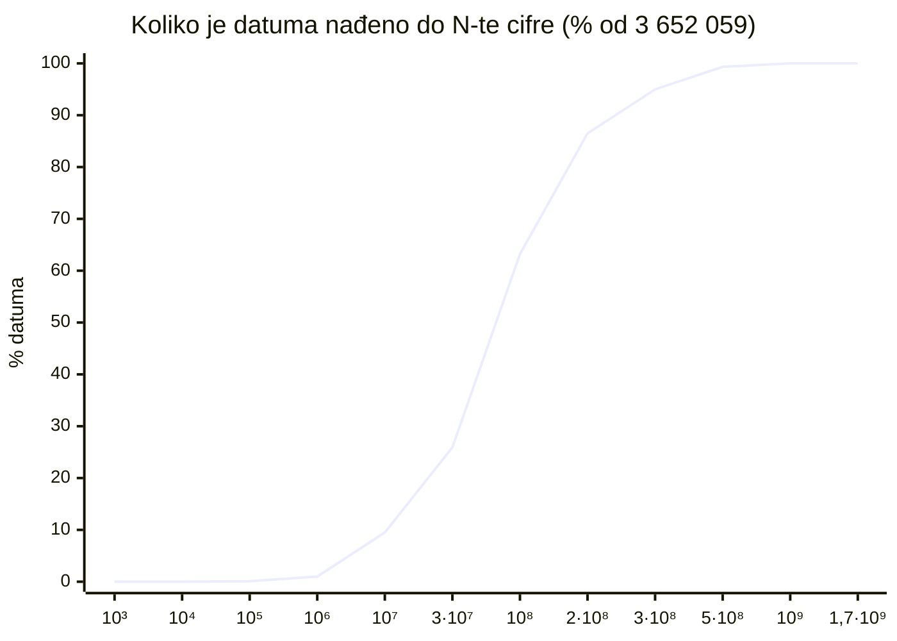
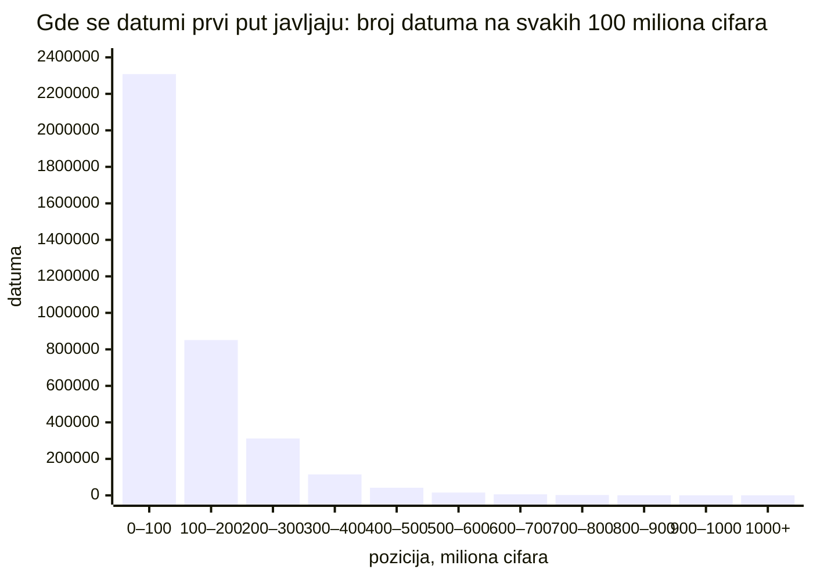
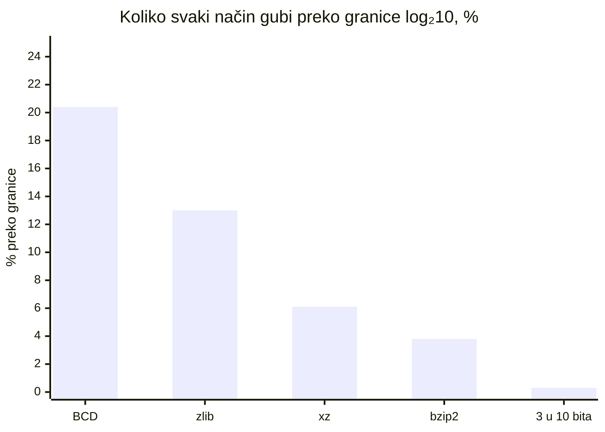
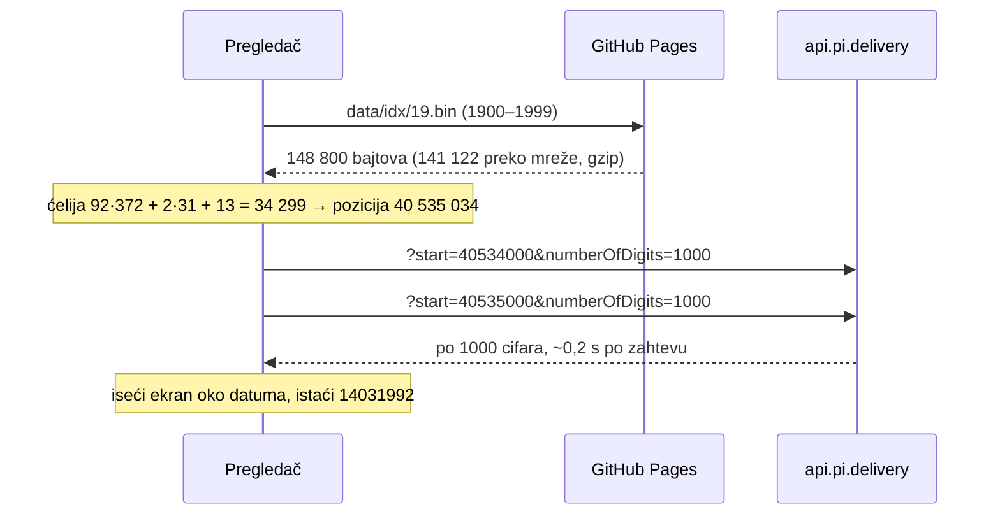
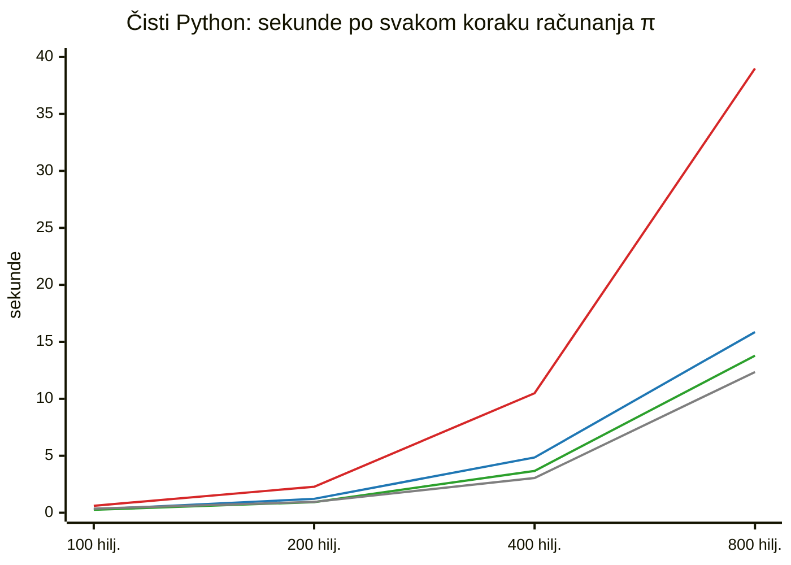
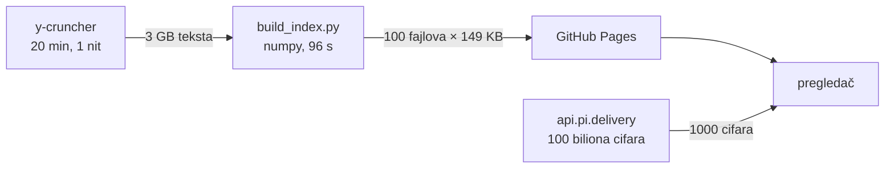

# π čuva sve, pa ja nisam morao da čuvam π

_Da li je tačno da je među beskonačnim ciframa broja π zapisan svaki niz cifara?_\
_Pa samim tim i svaki datum iz kalendara?_\
_Koji se datum u π javlja prvi, a koji se krije najdublje?_\
_I kako naći svoj datum rođenja, a ne čuvati nijednu cifru broja π?_

~~Sa merenjima i grafikonima.~~ U slikama, za najmlađe.

[English](article-2026.md){: hreflang=en } · [Русский](article-2026.ru.md){: hreflang=ru }

---

## Da li je tačno da u π ima svega?

Broj [π](https://sr.wikipedia.org/sr-el/Пи) je odnos obima kruga i njegovog prečnika, 3,14159265… Njegove decimale se ne završavaju i nikad ne upadaju u petlju. To je dokazao još [Lambert](https://sr.wikipedia.org/sr-el/Јохан_Хајнрих_Ламберт) 1761. godine: π je [iracionalan broj](https://sr.wikipedia.org/sr-el/Ирационалан_број).

Matematičari veruju da je π [normalan broj](https://sr.wikipedia.org/sr-el/Нормалан_број). To znači da se u njegovom zapisu svaka cifra javlja u jednom slučaju od deset, svaki par cifara u jednom od sto, a svaka osmorka cifara u jednom od sto miliona. Kao da je neko cifre broja π bacao na poštenoj desetostranoj kockici!

Ako je tako, onda je u π zapisan svaki konačan niz cifara. Vaš broj telefona. Broj vaše kreditne kartice. Tekst ovog zapisa u bilo kom kodiranju. Prava Borhesova [Vavilonska biblioteka](https://sr.wikipedia.org/sr-el/Вавилонска_библиотека), samo beskonačna.

Ali normalnost broja π zasad je samo hipoteza. Provere na bilionima cifara se slažu s njom, a dokaza nema. Nije dokazano čak ni to da se sedmica u π javlja beskonačno mnogo puta!

## Dokazati ne ide. A kako to osetiti?

Svaki datum može se zapisati sa osam cifara zaredom. Moj rođendan pada na [Dan broja π](https://sr.wikipedia.org/sr-el/Дан_броја_пи), i 14.03.1992 postaje `14031992`. Svaka cifra se u π javlja jednom na deset cifara, svaki par jednom na sto, a svaka osmorka cifara jednom na sto miliona. Znači, i vaš datum se u π pojavljuje otprilike jednom na sto miliona cifara. Kad biste odštampali sto miliona cifara, dobili biste sto tomova po 330 strana. Jedan zid polica s knjigama, i vaš rođendan je negde u njemu!

Otvorite https://favorart.github.io/pi-birthday/, unesite svoj datum rođenja i pritisnite „Find“ („Pronađi“). Usred zida cifara crveno će se upaliti vaš rođendan, a levo od njega redni broj mesta. Moj se našao na 40 535 034. cifri posle zareza:

A sad to pokažite detetu, i dalje će ono samo postavljati pitanja. A mamin datum? A tatin? Ima li datuma kojeg u π nema? (Spojler: nema takvog.) A koji je skriven najdublje?

## Koliko cifara broja π zaista treba?

Datuma od 01.01.0001 do 31.12.9999 ima **3 652 059**, i na svaki u proseku treba čekati sto miliona cifara. Ali „u proseku“ ovde vara.

Evo kako se datumi sakupljaju dok idemo kroz π. Koraci na osi nisu jednaki, a najvažnija je sredina: do 69 miliona cifara (10⁸ · ln 2) nađena je polovina datuma, do 10⁸ — 63 %, do pola milijarde — 99,3 %. Poslednjih 0,7 % razvlači se na još više od milijarde cifara.

_Linija se poklapa sa formulom 1 − e^(−N/10⁸)._

Nas ne zanima prosek, nego **najkasniji** od 3,65 miliona datuma: upravo on odlučuje koliko cifara treba izračunati.

Može se proceniti jednostavnim rasuđivanjem. Krenimo kroz cifre broja π i hvatajmo datume. Dok nijedan nije uhvaćen, zamki ima N = 3 652 059, i prvi datum se uhvati gotovo odmah: u proseku posle 10⁸ / N cifara. Zatim ima jedna zamka manje, i sledeći datum se čeka malo duže. I tako do samog poslednjeg, koji se hvata sam i čeka punih 10⁸. Saberimo očekivanja: 10⁸ · (1/N + 1/(N−1) + … + 1/2 + 1).

Zbir u zagradi je [harmonijski broj](https://en.wikipedia.org/wiki/Harmonic_number){: hreflang=en } H_N. Za veliko N on je gotovo jednak ln N + 0,577, gde je 0,577 [Ojler-Maskeronijeva konstanta](https://sr.wikipedia.org/sr-el/Ојлер-Маскеронијева_константа). Za naše datume ispada 15,69, pa ćemo na poslednji datum čekati otprilike 10⁸ · 15,69 ≈ **1,57 milijardi cifara**. To je procena u proseku: u stvarnosti se poslednji datum može naći i ranije i kasnije. To je [problem sakupljača kupona](https://en.wikipedia.org/wiki/Coupon_collector%27s_problem){: hreflang=en }, kao sa sličicama iz žvaka: prve stižu u gomilama, a poslednju čekaš najduže.

Rep se vidi ako se prebroji koliko se datuma prvi put pojavi u svakih sto miliona cifara:

U prvom stupcu je više od polovine svih datuma, 2,3 miliona od 3,65, a svaki sledeći je niži od prethodnog gotovo tačno e ≈ 2,7 puta: tako izgleda [eksponencijalna raspodela](https://sr.wikipedia.org/sr-el/Eksponencijalna_raspodela). Desno je dugačak rep: dalje od milijarde leže 154 najnesrećnija datuma.

## A kako to radi?

Godine 2018. [mom programu](/sr/writing/pi-birthday/) (bez interneta) bio je potreban tekstualni fajl od 3 GB: tri milijarde cifara broja π, po bajt za cifru, izračunatih „za svaki slučaj“, skoro duplo više nego što treba. I još tabela „datum → pozicija“ sa 3,65 miliona redova, koju je Python parsirao 4 sekunde!

Danas sam poželeo da čitaoci ovog zapisa mogu sami da izvedu isti eksperiment, pa sam se prihvatio da stari programčić pretvorim u veb-formu na GitHub Pages. Samo što GitHub [ne prima fajlove veće od 100 MB](https://docs.github.com/en/repositories/working-with-files/managing-large-files/about-large-files-on-github){: hreflang=en }, a moj fajl je trideset puta veći. Traženje izlaza me je toliko zaokupilo da je iz njega izrastao novi zapis. Jer sajtu fajl s ciframa uopšte nije bio potreban! Kako je to ispalo?

## 1. Možda se π može sabiti?

Prva misao: 3 GB teksta od samih cifara sigurno će se sabiti. Sabio sam prvih 10 miliona cifara i rezultat pomnožio sa 300, jer kod slučajnih cifara stepen kompresije ne zavisi od dužine:

| Način | 3 milijarde cifara | Bita po cifri | Direktan pristup N-toj cifri |
|---|---|---|---|
| ASCII tekst | 3,00 GB | 8 | da |
| zlib -9 | 1,41 GB | 3,75 | ne |
| bzip2 -9 | 1,29 GB | 3,45 | ne |
| xz (lzma -9) | 1,32 GB | 3,52 | ne |
| 2 cifre u bajtu ([BCD](https://sr.wikipedia.org/sr-el/Бинарно_кодирани_децимални_број)) | 1,50 GB | 4 | da |
| 3 cifre u 10 bita | 1,250 GB | 3,33 | da |
| Teorijska granica | 1,246 GB | log₂10 ≈ 3,32 | — |

Odakle granica? Jedna cifra je izbor između deset jednako verovatnih mogućnosti. Tri bita su dovoljna samo za 8 mogućnosti, četiri bita daju 16, i šest od njih propada uzalud. Tačno deset mogućnosti je log₂10 ≈ 3,32 bita, jer je 2^3,32 ≈ 10. Ako su cifre slučajne, manje se u proseku ne može: to je Šenonova [entropija](https://sr.wikipedia.org/sr-el/Ентропија_(теорија_информација)).

Zato grafikon ne prikazuje same bitove, nego koliko svaki način gubi preko granice. ASCII ne bi stao ovde: +141 %. Arhiveri gube od 4 do 13 %, a glupo pakovanje „tri cifre u 10 bita“ svega 0,3 %:

Arhiveri traže ponavljanja, a u π ih nema. Svaka cifra se javlja gotovo tačno u 10 % slučajeva (od 999 333 do 1 001 093 puta na 10 miliona), a sledeća ne zavisi od prethodnih. Arhiveru ostaje samo da izbaci suvišne bitove iz ASCII koda. S tim izlazi na kraj i pakovanje „tri cifre u 10 bita“ (1000 mogućnosti od 1024), i to bolje, brže i bez gubitka direktnog pristupa: adresa N-te cifre izračunava se formulom.

Ishod: 3 milijarde cifara nijedan arhiver neće sabiti ispod **1,25 GB**. A GitHub Pages ima [ograničenje](https://docs.github.com/en/pages/getting-started-with-github-pages/github-pages-limits){: hreflang=en } od 1 GB za ceo sajt. Ćorsokak.

## 2. A ako čuvamo samo ono što se vidi na ekranu?

Na ekranu ionako nema 3 milijarde cifara. Otvorio sam snimak ekrana programa iz 2018. i prebrojao: 11 redova po 42 cifre. Ukupno oko **460 cifara** po ekranu, od toga 8 čini sam datum, koji ne treba čuvati.

Znači, za svaki datum može se čuvati prozor od oko 450 cifara oko njega. Cifre ćemo spakovati po tri u 10 bita i dodati 4 bajta za poziciju:

| Prozor oko datuma | Cifara po datumu | Ukupno za 3,65 miliona datuma |
|---|---|---|
| ±20 | 40 | 76 MB |
| ±50 | 100 | 167 MB |
| ±100 | 200 | 319 MB |
| ekran iz 2018. | ~450 | **~700 MB** |
| ±400 | 800 | 1,23 GB |
| ekran, datum bilo gde | 904 | 1,39 GB |
| ±500 | 1000 | 1,54 GB |

Ekran iz 2018. staje, ali tesno, i svako ažuriranje sajta pretvara se u otpremanje stotina megabajta. A ako se datum prikazuje na nasumičnom mestu ekrana, kao u originalu, prozor se udvostručuje. Već pri ±400 cifara svi prozori zajedno teže skoro istih 1,25 GB kao i ceo π, od kojeg smo bežali.

## 3. A šta ako uopšte ne čuvamo π?

Cifre broja π već neko čuva. Godine 2022. Google Cloud je [izračunao 100 biliona cifara](https://cloud.google.com/blog/products/compute/calculating-100-trillion-digits-of-pi-on-google-cloud){: hreflang=en } (tadašnji svetski rekord) i deli ih preko API-ja: [`api.pi.delivery`](https://pi.delivery/){: hreflang=en } vraća do 1000 cifara po zahtevu, sa [CORS](https://sr.wikipedia.org/sr-el/Preuzimanje_resursa_sa_različitih_izvora)-om, besplatno. Znači, sajt treba da zna samo jedno: **gde** da traži.

Indeks ispada trivijalan: za svaki datum jedan 32-bitni broj, redni broj cifre posle zareza od koje datum počinje. 3 milijarde staju u 32 bita (4,29 milijardi), dakle 4 bajta po datumu.

Raspored je 100 fajlova, po jedan za svaki vek. Unutra: 100 godina × 12 meseci × 31 dan × 4 bajta = **148 800 bajtova**. Adresa datuma izračunava se jednom formulom, bez ikakve pretrage: broj ćelije = godina unutar veka × 372 + (mesec − 1) × 31 + (dan − 1). Cena su prazne ćelije za 30. februar, 31. april i ostale nepostojeće dane: ima ih 67 941, 1,8 % indeksa. Za moj datum pregledač preuzima jedan fajl veka i šalje dva zahteva API-ju: ekran oko 40 535 034 prelazi granicu hiljade.

2018. i 2026. jedna pored druge:

| | 2018, desktop | 2026, pregledač |
|---|---|---|
| Cifre broja π | 3 GB na disku | 0 bajtova, uzimaju se iz API-ja |
| Tabela datuma | tekst, ~74 MB, čitanje 4,1 s | 14,9 MB na serveru |
| Preuzima se po datumu | — | 141 KB indeksa + ~2 KB cifara |
| Pokretanje | pozadinska nit, da se prozor ne bi zamrzao | trenutno |

### A može li se sam indeks sabiti?

Entropija pozicija je oko 28 bita od 32, pa se može dobiti najviše 12 %. Arhiveri iscede 3–6 %, a GitHub Pages ionako šalje fajlove u gzip-u, pa nisam izmišljao sopstveni format.

## 4. Kako izračunati 3 milijarde cifara na laptopu?

Godine 2018. našao sam na forumu [programčić](http://www.cyberforum.ru/qbasic/thread1923079.html#post10542354){: hreflang=ru }, pokrenuo ga i čekao. Ovaj put sam odlučio da prvo proverim za šta je sposoban goli Python.

[Formula Čudnovskih](https://en.wikipedia.org/wiki/Chudnovsky_algorithm){: hreflang=en } daje oko 14 cifara po članu reda i piše se u čistom Python-u u 30 redova ([gen_test_digits.py](https://github.com/favorart/pi-birthday/blob/main/tools/gen_test_digits.py){: hreflang=en }). 800 hiljada cifara izračuna za 81 sekundu. Nije loše? Samo što svako udvostručenje broja cifara košta četiri puta više vremena:

_Crvena linija je završno deljenje, plava pretvaranje u string, zelena kvadratni koren, siva sam red._

Sam red je najjeftiniji deo! Najduže traje jedno jedino deljenje na kraju. Deljenje, koren i pretvaranje u string kod velikih brojeva u CPython-u 3.8 rade školskim, kvadratnim algoritmima. Pretvaranje u string je toliko sporo da je 2022. proglašeno ranjivošću: [CVE-2020-10735](https://nvd.nist.gov/vuln/detail/CVE-2020-10735){: hreflang=en }, broj je rezervisan još 2020. Od jeseni 2022. Python (3.11 i ažuriranja starijih verzija) podrazumevano jednostavno odbija da ispiše broj duži od 4300 cifara.

Sad pomnožimo: tri milijarde je 3 750 puta više od 800 hiljada, a kvadrat daje faktor od 14 miliona. U čistom Python-u moj laptop bi računao π **oko 36 godina**.

Zato sam uzeo [y-cruncher](http://www.numberworld.org/y-cruncher/){: hreflang=en }, program kojim se postavljaju svetski rekordi u računanju broja π. Čak i u najskromnijem režimu (jedna nit, 4 GB memorije, ostatak na disku) izračunao je 3 milijarde cifara za **20 minuta**. Za isti minut i po y-cruncher izbaci oko 240 miliona cifara.

## 5. Kako naći 3,65 miliona datuma u 3 milijarde cifara?

[Program iz 2018.](/sr/writing/pi-birthday/) išao je kroz π prozorom od 8 cifara: na svakom koraku lepio je od njih string „DD.MM.GGGG“ i tražio ga u rečniku. Izmerio sam taj pristup na 2 miliona cifara (već na Python-u 3): 0,53 miliona cifara u sekundi, za ceo prolaz oko 54 minuta.

A Python 2.7 je dodavao svoje. Brojač pozicije pri prolasku kroz string čuvao se tamo u 32-bitnom broju (na Windows-u čak i u 64-bitnoj verziji), i na oznaci od 2,1 milijarde program je padao sa greškom „iter index too large“. Fajl s ciframa morao je da se seče na komade od po milijardu.

Godine 2026. isto to radi [numpy](https://numpy.org/){: hreflang=en }, i to ne poziciju po poziciju, nego celim nizovima. Osam kopija niza cifara, pomerenih za 0…7 pozicija, sabira se tako da se na svakoj poziciji odmah dobije osmocifreni broj DDMMGGGG. Tabela od 10⁸ zastavica govori da li je to pravi datum, a prvo pojavljivanje svakog datuma numpy nalazi sam.

Ispada 18 miliona cifara u sekundi, 33 puta brže od pristupa iz 2018. Memorije treba oko 0,5 GB: dve tabele po 10⁸ elemenata plus komad broja π od 50 miliona cifara. Ceo prolaz trajao je **96 sekundi** i zaustavio se sam, mnogo pre kraja fajla: više nije bilo šta da se traži.

## 6. Pa šta se našlo?

Svih 3 652 059 datuma je nađeno. I π se ponašao tačno onako kako predviđa teorija slučajnih cifara:

| | Teorija | Stvarno |
|---|---|---|
| Prosečna pozicija | 100 000 000 | 99 930 807 |
| Medijana | 69 314 718 | 69 274 900 |
| Najkasniji datum | ~1 568 800 000 | 1 669 501 859 |
| Najraniji datum | ~27 | 63 |

Prognoza s početka zapisa promašila je najkasniji datum za 6 %, ali rasipanje takvog rekorda je oko 130 miliona cifara (π/√6 · 10⁸: π se i ovde ušunjao), tako da je promašaj od 100 miliona u granicama normale. Prosečne pozicije po vekovima leže u koridoru 98,0–101,6 miliona: π ne favorizuje i ne zapostavlja nijednu epohu.

Malo rekorda i kurioziteta:

- **Najraniji** je 23.07.8164, na 63. cifri: `…5923078164…`. U prvoj hiljadi cifara ima svega 33 datuma, u prvom milionu 36 303, odnosno 1 %.
- **Najkasniji** je 12.02.6987, na **1 669 501 859.** cifri. Po dubini za njim slede 17.02.9995 (1,50 milijardi) i 10.03.6087 (1,46 milijardi).
- **01.01.1970**, početak [Unix epohe](https://en.wikipedia.org/wiki/Unix_time){: hreflang=en }, nalazi se na 6 297 536. cifri. **01.01.2000** je na 181 946 674., a predvečerje milenijuma **31.12.1999** čak na 498 894 645. cifri: dublje leži manje od 1 % datuma.
- **11.11.1111** po teoriji čeka najduže. String `11111111` preklapa se sam sa sobom: jedinice idu u gomilama, gde se našao jedan takav string, često je u blizini i drugi, a razmaci između gomila su duži. Zato očekivano vreme do prvog pojavljivanja za njega nije 10⁸, nego 111 111 110 = 10 + 100 + … + 10⁸ ([Konvejevi „vodeći brojevi“](https://en.wikipedia.org/wiki/Penney%27s_game){: hreflang=en }). Našao se na 159 090 113. cifri, kasnije od proseka, ali po jednom datumu ništa se ne može dokazati. Njegovi rođaci `12121212` i `10101010` (12.12.1212 i 10.10.1010) preklapaju se sa pomakom od dve cifre i u proseku čekaju 1 % duže od običnog datuma; 12.12.1212, na primer, našao se već na 88 168 706. cifri.

Hteo sam u isti niz primera da ubacim i Isusov rođendan: bio sam siguran da je to 01.01.0001. Pokazalo se da nije: brojanje godina „od Hristovog rođenja“ smislio je 525. godine monah [Dionisije Mali](https://sr.wikipedia.org/sr-el/Дионисије_Мали), i po njegovom računu (u uobičajenom tumačenju) Božić je bio 25. decembra 1. godine pre nove ere, nedelju dana pre početka ere. A 1. januar je osmi dan posle Božića, praznik [Obrezanja Gospodnjeg](https://sr.wikipedia.org/sr-el/Обрезање_Исуса_Христа).

A [nulte godine](https://sr.wikipedia.org/sr-el/0_(година)) kod nas uopšte i nema: posle 1. godine pre nove ere odmah dolazi 1. godina nove ere. Zato u indeksu datuma nije bilo ni nulte godine. Ali astronomi 1. godinu pre nove ere upravo tako i zapisuju, kao nultu, pa sam je dodao na sajt. Datum od kojeg se broje vekovi, 25.12.0000, našao se tek na 280 255 197. cifri: dublje se krije svega 6 % datuma. To je katolički Božić, ali postoji i pravoslavni. Rekli biste da je to 07.01.0001, na 166 284 266. cifri. Ali pravoslavni računaju po [julijanskom kalendaru](https://sr.wikipedia.org/sr-el/Јулијански_календар), a 1. godine pre nove ere kalendari su se razlikovali za svega dva dana. Tako je tada pravoslavni Božić po našem kalendaru padao na 23.12.0000 i našao se mnogo ranije, na 50 494 078. cifri.

Svu statistiku iznad računao sam još bez „izgubljene“ nulte godine i nisam je preračunavao: njenih 366 datuma pomeraju prosek i medijanu za hiljadite delove procenta, a rekorde uopšte ne menjaju.

## 7. Šta smo na kraju dobili?

Broj π uopšte nije morao da se čuva: cifre daje Google, a sajtu su dovoljna 4 bajta po datumu.

Najskuplje računanje u projektu je 20 minuta na jednom jezgru laptopa, i više nikad neće morati da se ponavlja.

A normalnost broja π i dalje niko nije dokazao. Ali 3 652 059 datuma razišlo se s teorijom slučajnih cifara u proseku i medijani za manje od desetog dela procenta. Dokaz to neće postati, ali je sad mnogo lakše poverovati u beskonačnu biblioteku.

A koji biste datum vi prvi proverili? Možete ga naći ovde: https://favorart.github.io/pi-birthday/
