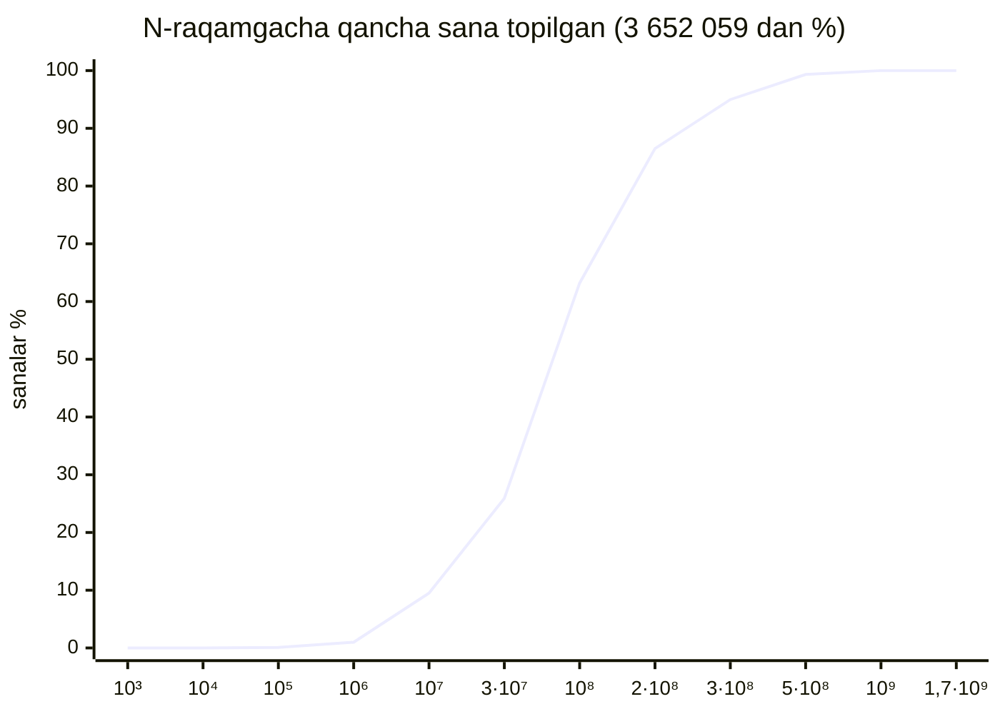
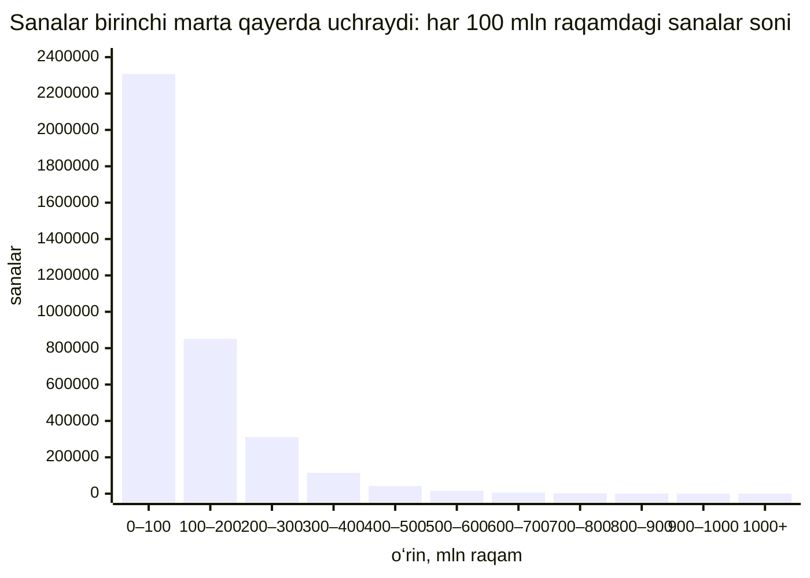
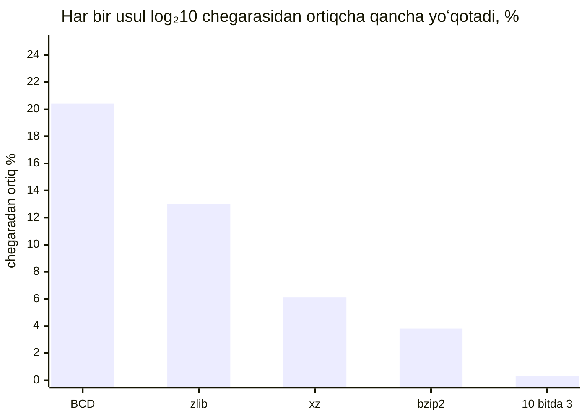
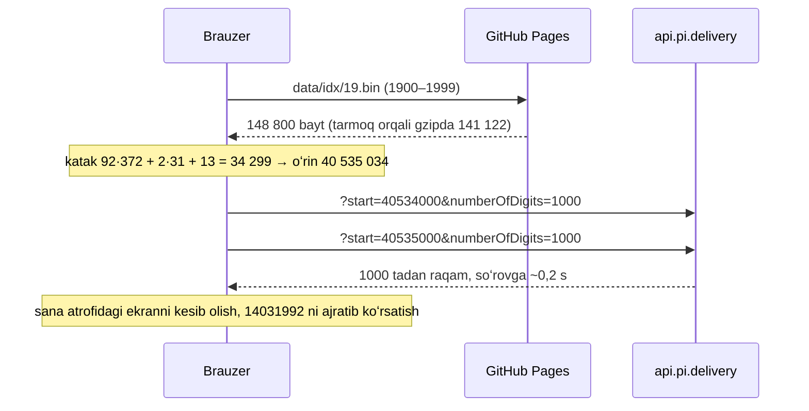
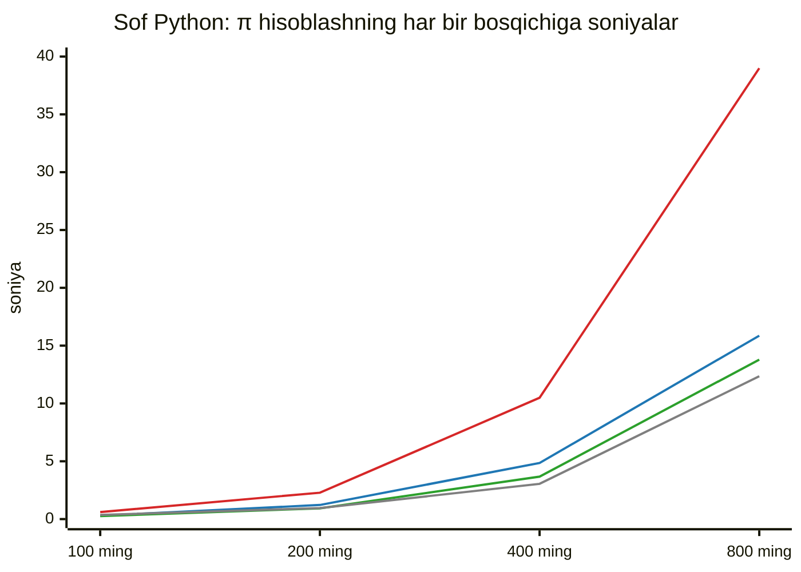
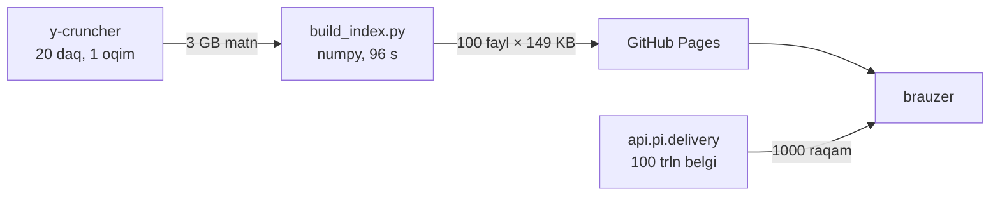

# π hamma narsani saqlaydi, shuning uchun men π sonini saqlamasam ham boʻldi

_π sonining cheksiz raqamlari orasida istalgan raqamlar ketma-ketligi yozilgani rostmi?_\
_Demak, kalendardagi istalgan sana ham?_\
_π sonida qaysi sana hammadan oldin uchraydi, qaysi biri esa eng chuqurga yashiringan?_\
_Va π sonining birorta ham raqamini saqlamay turib, tugʻilgan kuningizni qanday topish mumkin?_

~~Oʻlchovlar va grafiklar bilan.~~ Eng kichkintoylar uchun rasmlarda.

[English](article-2026.md){: hreflang=en } · [Русский](article-2026.ru.md){: hreflang=ru }

---

## π sonida hamma narsa bor, rostmi?

[π](https://uz.wikipedia.org/wiki/Pi) soni — aylana uzunligining uning diametriga nisbati, 3,14159265… Uning verguldan keyingi raqamlari tugamaydi va hech qachon davriy takrorlanmaydi. Buni [Lambert](https://uz.wikipedia.org/wiki/Iogann_Lambert) 1761-yildayoq isbotlagan: π — [irratsional son](https://uz.wikipedia.org/wiki/Irratsional_sonlar).

Matematiklar π [normal son](https://en.wikipedia.org/wiki/Normal_number){: hreflang=en } ekaniga ishonishadi. Bu shuni anglatadiki, uning yozuvida har bir raqam oʻn holatdan birida, har bir raqamlar juftligi yuztadan birida, har bir sakkiz raqamli ketma-ketlik yuz milliontadan birida uchraydi. Goʻyo π sonining raqamlarini kimdir halol oʻn qirrali zarni tashlab chiqargandek!

Agar shunday boʻlsa, π sonida istalgan chekli raqamlar ketma-ketligi yozilgan. Telefon raqamingiz. Kredit kartangiz raqami. Shu qaydning matni istalgan kodlashda. Borxesning haqiqiy [Bobil kutubxonasi](https://en.wikipedia.org/wiki/The_Library_of_Babel){: hreflang=en }, faqat u cheksiz.

Lekin π sonining normalligi hozircha faqat gipoteza. Trillionlab raqamlar ustidagi tekshiruvlar unga mos keladi, ammo isbot yoʻq. Hatto 7 raqami π sonida cheksiz koʻp marta uchrashi ham isbotlanmagan!

## Isbotlab boʻlmayapti. Unda buni qanday his qilish mumkin?

Istalgan sanani ketma-ket sakkizta raqam bilan yozish mumkin. Mening tugʻilgan kunim [Pi kuniga](https://en.wikipedia.org/wiki/Pi_Day){: hreflang=en } toʻgʻri keladi va 14.03.1992 `14031992` ga aylanadi. π sonida har bir raqam oʻn belgida bir marta, har bir juftlik yuzta belgida bir marta, har bir sakkiz raqamli ketma-ketlik esa yuz million belgida bir marta uchraydi. Demak, sizning sanangiz ham π sonida taxminan yuz million belgida bir marta uchraydi. Yuz million raqamni chop etsangiz, har biri 330 betdan iborat yuz jild chiqadi. Bitta kitob javoni — va tugʻilgan kuningiz qayerdadir uning ichida!

https://favorart.github.io/pi-birthday/ sahifasini oching, tugʻilgan sanangizni kiriting va «Find» (Topish) tugmasini bosing. Raqamlar devorining oʻrtasida tugʻilgan kuningiz qizil rangda yonadi, chap tomonda esa uning oʻrni raqami. Meniki verguldan keyingi 40 535 034-raqamda topildi:

Endi buni bolaga koʻrsating, keyingi savollarni u oʻzi beradi. Oyimning sanasi-chi? Dadamniki-chi? π sonida yoʻq sana bormi? (Spoyler: bunday sana yoʻq.) Eng chuqurga qaysi biri yashiringan?

## Aslida π sonining nechta raqami kerak?

01.01.0001 dan 31.12.9999 gacha **3 652 059** ta sana bor va har birini oʻrtacha yuz million belgi kutishga toʻgʻri keladi. Lekin bu yerda «oʻrtacha» degan soʻz aldamchi.

π boʻylab yurganimiz sari sanalar mana shunday yigʻiladi. Oʻqdagi qadamlar teng emas, eng muhimi esa — oʻrtasi: 69 mln belgigacha (10⁸ · ln 2) sanalarning yarmi topiladi, 10⁸ gacha — 63 %, yarim milliardgacha — 99,3 %. Oxirgi 0,7 % yana bir milliarddan ortiq raqamga choʻziladi.

_Chiziq 1 − e^(−N/10⁸) formulasi bilan ustma-ust tushadi._

Bizni oʻrtacha qiymat emas, 3,65 mln sananing **eng kechi** qiziqtiradi: aynan u nechta belgi hisoblash kerakligini hal qiladi.

Uni oddiy mulohaza bilan baholash mumkin. π raqamlari boʻylab yuramiz va sanalarni tutamiz. Hali birortasi tutilmagan paytda tuzoqlar soni N = 3 652 059 ta va birinchi sana deyarli darhol tuzoqqa tushadi: oʻrtacha 10⁸ / N belgidan keyin. Keyin tuzoqlar bittaga kamayadi va navbatdagi sanani biroz uzoqroq kutish kerak. Va shu tarzda eng oxirgisigacha: u yolgʻiz tutiladi va butun 10⁸ ni kutadi. Kutishlarni qoʻshamiz: 10⁸ · (1/N + 1/(N−1) + … + 1/2 + 1).

Qavs ichidagi yigʻindi — [garmonik son](https://en.wikipedia.org/wiki/Harmonic_number){: hreflang=en } H_N. Katta N uchun u deyarli ln N + 0,577 ga teng, bu yerda 0,577 — [Eyler doimiysi](https://en.wikipedia.org/wiki/Euler%27s_constant){: hreflang=en }. Bizning sanalar uchun 15,69 chiqadi, demak oxirgi sanani taxminan 10⁸ · 15,69 ≈ **1,57 mlrd belgi** kutish kerak. Bu oʻrtacha baho: amalda oxirgi sana ertaroq ham, kechroq ham topilishi mumkin. Bu — [kolleksioner masalasi](https://en.wikipedia.org/wiki/Coupon_collector%27s_problem){: hreflang=en }: xuddi saqich ichidan chiqadigan rasmchalar kabi: birinchilari toʻp-toʻp boʻlib keladi, oxirgisini esa hammadan uzoq kutasan.

Har yuz million raqamda nechta sana birinchi marta topilishini sanasak, «dum» koʻrinadi:

Birinchi ustunda barcha sanalarning yarmidan koʻpi bor — 3,65 mln dan 2,3 mln, va har bir keyingi ustun oldingisidan deyarli roppa-rosa e ≈ 2,7 marta past: [eksponensial taqsimot](https://en.wikipedia.org/wiki/Exponential_distribution){: hreflang=en } mana shunday koʻrinadi. Oʻngda — uzun dum: milliarddan nariroqda eng omadsiz 154 ta sana yotibdi.

## Bu qanday ishlaydi?

2018-yilda [mening dasturimga](/uz/writing/pi-birthday/) (internetsiz) 3 GB lik matn fayli kerak edi: π sonining uch milliard belgisi, har bir raqamga bir bayt, «ehtiyot shart» hisoblangan — keragidan deyarli ikki baravar koʻp. Yana 3,65 mln qatorli «sana → oʻrin» jadvali ham bor edi, uni Python 4 soniyada oʻqib chiqardi!

Bugun qayd oʻquvchilari xuddi shu tajribani oʻzlari oʻtkaza olishini xohladim va eski dasturchani GitHub Pagesdagi veb-shaklga oʻtkazishga kirishdim. Biroq GitHub [100 MB dan katta fayllarni qabul qilmaydi](https://docs.github.com/en/repositories/working-with-files/managing-large-files/about-large-files-on-github){: hreflang=en }, mening faylim esa oʻttiz baravar katta. Chiqish yoʻlini izlash meni shunchalik qiziqtirib qoʻydiki, undan yangi qayd oʻsib chiqdi. Axir saytga raqamlar fayli umuman kerak emas ekan! Bu qanday boʻldi?

## 1. Balki π sonini siqish mumkindir?

Birinchi fikr: faqat raqamlardan iborat 3 GB matn albatta siqiladi. Birinchi 10 mln belgini siqdim va natijani 300 ga koʻpaytirdim, chunki tasodifiy raqamlarda siqish darajasi uzunlikka bogʻliq emas:

| Usul | 3 mlrd raqam | Bir raqamga bit | N-raqamga toʻgʻridan-toʻgʻri kirish |
|---|---|---|---|
| ASCII matn | 3,00 GB | 8 | ha |
| zlib -9 | 1,41 GB | 3,75 | yoʻq |
| bzip2 -9 | 1,29 GB | 3,45 | yoʻq |
| xz (lzma -9) | 1,32 GB | 3,52 | yoʻq |
| baytda 2 raqam ([BCD](https://en.wikipedia.org/wiki/Binary-coded_decimal){: hreflang=en }) | 1,50 GB | 4 | ha |
| 10 bitda 3 raqam | 1,250 GB | 3,33 | ha |
| Nazariy chegara | 1,246 GB | log₂10 ≈ 3,32 | — |

Chegara qayerdan kelgan? Bitta raqam — oʻnta teng ehtimolli variantdan biri. Uch bit faqat 8 variantga yetadi, toʻrt bit 16 ta beradi va ulardan oltitasi behuda ketadi. Roppa-rosa oʻnta variant — bu log₂10 ≈ 3,32 bit, chunki 2^3,32 ≈ 10. Agar raqamlar tasodifiy boʻlsa, oʻrtacha bundan kam boʻlmaydi: bu Shennon boʻyicha [entropiya](https://en.wikipedia.org/wiki/Entropy_(information_theory)){: hreflang=en }.

Shuning uchun grafikda bitlarning oʻzi emas, har bir usul chegaradan ortiqcha qancha yoʻqotishi koʻrsatilgan. ASCII bu yerga sigʻmasdi: +141 %. Arxivatorlar 4 dan 13 % gacha yoʻqotadi, «uch raqam 10 bitga» degan oddiygina joylash esa atigi 0,3 %:

Arxivatorlar takrorlarni qidiradi, π sonida esa ular yoʻq. Har bir raqam deyarli roppa-rosa 10 % hollarda uchraydi (10 mln da 999 333 dan 1 001 093 martagacha), keyingisi esa oldingilariga bogʻliq emas. Arxivatorga faqat ASCII kodidagi ortiqcha bitlarni tashlab yuborish qoladi. Buni «uch raqam 10 bitga» joylash ham (1024 tadan 1000 variant) uddalaydi — boz ustiga yaxshiroq, tezroq va toʻgʻridan-toʻgʻri kirishni yoʻqotmasdan: N-raqamning manzili formula bilan hisoblanadi.

Xulosa: hech bir arxivator 3 mlrd belgini **1,25 GB** dan kichik qilib siqmaydi. GitHub Pagesning butun sayt uchun [limiti](https://docs.github.com/en/pages/getting-started-with-github-pages/github-pages-limits){: hreflang=en } esa — 1 GB. Boshi berk koʻcha.

## 2. Faqat ekranda koʻrinadiganini saqlasak-chi?

Baribir ekranda 3 mlrd raqam yoʻq. 2018-yilgi dastur skrinshotini ochib sanadim: 42 raqamdan 11 qator. Jami ekranga taxminan **460 raqam**, ulardan 8 tasi sananing oʻzi, uni saqlash shart emas.

Demak, har bir sana uchun uning atrofidagi taxminan 450 raqamli oynani saqlash mumkin. Raqamlarni uchtadan 10 bitga joylaymiz va oʻrin uchun 4 bayt qoʻshamiz:

| Sana atrofidagi oyna | Bir sanaga raqam | 3,65 mln sana uchun jami |
|---|---|---|
| ±20 | 40 | 76 MB |
| ±50 | 100 | 167 MB |
| ±100 | 200 | 319 MB |
| 2018-yilgi ekran | ~450 | **~700 MB** |
| ±400 | 800 | 1,23 GB |
| ekran, sana istalgan joyda | 904 | 1,39 GB |
| ±500 | 1000 | 1,54 GB |

2018-yilgi ekran sigʻadi, lekin zoʻrgʻa, va saytning har bir yangilanishi yuzlab megabaytni yuklashga aylanadi. Agar sanani asl nusxadagidek ekranning tasodifiy joyida koʻrsatsak, oyna ikki baravar kattalashadi. ±400 raqamdayoq barcha oynalar birgalikda deyarli oʻsha 1,25 GB ni — biz qochmoqchi boʻlgan butun π hajmini egallaydi.

## 3. π sonini umuman saqlamasak-chi?

π raqamlarini allaqachon kimdir saqlayapti. 2022-yilda Google Cloud [100 trillion belgini hisobladi](https://cloud.google.com/blog/products/compute/calculating-100-trillion-digits-of-pi-on-google-cloud){: hreflang=en } — oʻsha paytdagi jahon rekordi — va ularni API orqali tarqatadi: [`api.pi.delivery`](https://pi.delivery/){: hreflang=en } bir soʻrovga 1000 tagacha raqam beradi, [CORS](https://en.wikipedia.org/wiki/Cross-origin_resource_sharing){: hreflang=en } bilan, bepul. Demak, sayt faqat bitta narsani bilishi kerak: **qayerdan** qidirishni.

Indeks juda oddiy boʻlib chiqadi: har bir sana uchun bitta 32 bitli son — sana boshlanadigan, verguldan keyingi raqamning tartib raqami. 3 mlrd 32 bitga sigʻadi (4,29 mlrd), demak bir sanaga 4 bayt.

Joylashuv — 100 ta fayl, har bir asrga bittadan. Ichida: 100 yil × 12 oy × 31 kun × 4 bayt = **148 800 bayt**. Sananing manzili hech qanday qidiruvsiz, bitta formula bilan hisoblanadi: katak raqami = asr ichidagi yil × 372 + (oy − 1) × 31 + (kun − 1). Buning uchun 30-fevral, 31-aprel va boshqa mavjud boʻlmagan kunlar uchun boʻsh kataklar bilan toʻlashga toʻgʻri keladi: ular 67 941 ta, indeksning 1,8 %. Mening sanam uchun brauzer bitta asr faylini yuklab oladi va APIga ikkita soʻrov yuboradi: 40 535 034 atrofidagi ekran mingtalik chegarasini kesib oʻtadi.

2018 va 2026 yonma-yon:

| | 2018, desktop | 2026, brauzer |
|---|---|---|
| π raqamlari | diskda 3 GB | 0 bayt, APIdan olinadi |
| Sanalar jadvali | matn, ~74 MB, oʻqish 4,1 s | serverda 14,9 MB |
| Bir sana uchun yuklanadi | — | indeksdan 141 KB + ~2 KB raqam |
| Ishga tushish | oyna qotib qolmasligi uchun fon oqimi | bir zumda |

### Indeksning oʻzini siqish mumkinmi?

Oʻrinlarning entropiyasi 32 bitdan taxminan 28 bit, demak koʻpi bilan 12 % yutish mumkin. Arxivatorlar 3–6 % siqib chiqaradi, GitHub Pages esa fayllarni baribir gzipda beradi, shuning uchun oʻz formatimni oʻylab topib oʻtirmadim.

## 4. Noutbukda 3 mlrd belgini qanday hisoblash mumkin?

2018-yilda forumdan bir [dasturcha](http://www.cyberforum.ru/qbasic/thread1923079.html#post10542354){: hreflang=ru } topdim, ishga tushirdim va kutdim. Bu safar avval hech qanday qoʻshimchasiz sof Python nimaga qodirligini tekshirib koʻrishga qaror qildim.

[Chudnovskiy formulasi](https://en.wikipedia.org/wiki/Chudnovsky_algorithm){: hreflang=en } qatorning har bir hadiga taxminan 14 belgi beradi va sof Pythonda 30 qatorda yoziladi ([gen_test_digits.py](https://github.com/favorart/pi-birthday/blob/main/tools/gen_test_digits.py)). 800 ming belgini u 81 soniyada hisoblaydi. Yomon emasmi? Biroq belgilar sonini har safar ikki baravar oshirish toʻrt baravar koʻp vaqt talab qiladi:

_Qizil chiziq — yakuniy boʻlish, koʻk — satrga aylantirish, yashil — kvadrat ildiz, kulrang — qatorning oʻzi._

Qatorning oʻzi — eng arzon qism! Eng uzoq davom etadigani — oxiridagi birgina boʻlish amali. CPython 3.8da katta sonlarni boʻlish, ildiz chiqarish va satrga aylantirish maktabdagi kvadratik algoritmlar bilan ishlaydi. Satrga aylantirish shunchalik sekinki, 2022-yilda uni zaiflik deb tan olishdi — [CVE-2020-10735](https://nvd.nist.gov/vuln/detail/CVE-2020-10735){: hreflang=en }, raqami esa 2020-yildayoq band qilingan. 2022-yil kuzidan boshlab Python (3.11 va eski versiyalarning yangilanishlari) sukut boʻyicha 4300 raqamdan uzun sonni chop etishdan shunchaki bosh tortadi.

Endi koʻpaytiramiz: uch milliard 800 mingdan 3 750 baravar koʻp, kvadratik algoritmda esa vaqt 14 million baravar oshadi. Sof Pythonda noutbukim π sonini **taxminan 36 yil** hisoblagan boʻlardi.

Shuning uchun π boʻyicha jahon rekordlari oʻrnatiladigan dastur — [y-cruncher](http://www.numberworld.org/y-cruncher/){: hreflang=en }ni oldim. Hatto eng kamtarona rejimda ham (bitta oqim, 4 GB xotira, qolgani diskda) u 3 mlrd belgini **20 daqiqada** hisobladi. Oʻsha bir yarim daqiqada y-cruncher taxminan 240 million belgi chiqaradi.

## 5. 3 mlrd raqam ichidan 3,65 mln sanani qanday topish mumkin?

[2018-yilgi dastur](/uz/writing/pi-birthday/) π boʻylab 8 raqamli oyna bilan yurardi: har qadamda ulardan «KK.OO.YYYY» satrini yopishtirib, uni lugʻatdan qidirardi. Bu yondashuvni 2 mln raqamda oʻlchab koʻrdim (endi Python 3da): soniyasiga 0,53 mln raqam, butun oʻtish uchun — taxminan 54 daqiqa.

Python 2.7 esa oʻzinikini qoʻshardi. U yerda satr boʻylab yurishdagi oʻrin hisoblagichi 32 bitli sonda saqlanardi — Windowsda hatto 64 bitli yigʻmada ham, — va 2,1 mlrd belgiga yetganda dastur «iter index too large» xatosi bilan qulab tushardi. Raqamlar faylini milliardtalik boʻlaklarga kesishga toʻgʻri kelardi.

2026-yilda xuddi shu ishni [numpy](https://numpy.org/){: hreflang=en } bajaradi — bittalab oʻrin boʻyicha emas, butun massivlar bilan. Raqamlar massivining 0…7 oʻringa surilgan sakkizta nusxasi shunday qoʻshiladiki, har bir oʻrinda darhol KKOOYYYY koʻrinishidagi sakkiz xonali son hosil boʻladi. 10⁸ ta bayroqchadan iborat jadval bu haqiqiy sanami yoki yoʻqmi, shuni aytadi, har bir sananing birinchi uchrashini esa numpy oʻzi topadi.

Natija — soniyasiga 18 mln raqam, 2018-yilgi yondashuvdan 33 baravar tez. Taxminan 0,5 GB xotira kerak: 10⁸ elementli ikkita jadval va π sonining 50 mln raqamli boʻlagi. Butun oʻtish **96 soniya** davom etdi va fayl oxiridan ancha oldin oʻzi toʻxtadi: qidiradigan narsa qolmadi.

## 6. Xoʻsh, nima topildi?

Barcha 3 652 059 ta sana topildi. Va π oʻzini tasodifiy raqamlar nazariyasi bashorat qilganidek tutdi:

| | Nazariya | Fakt |
|---|---|---|
| Oʻrtacha oʻrin | 100 000 000 | 99 930 807 |
| Mediana | 69 314 718 | 69 274 900 |
| Eng kech sana | ~1 568 800 000 | 1 669 501 859 |
| Eng erta sana | ~27 | 63 |

Qayd boshidagi bashorat eng kech sana boʻyicha 6 % ga adashdi, lekin bunday rekordning tarqoqligi taxminan 130 mln belgi (π/√6 · 10⁸: π bu yerga ham suqilib kirib olgan), shuning uchun 100 mln ga adashish — meʼyor doirasida. Asrlar boʻyicha oʻrtacha oʻrinlar 98,0–101,6 mln yoʻlagida yotadi: π hech bir davrni na yaxshi koʻradi, na xafa qiladi.

Bir oz rekordlar va qiziq holatlar:

- **Hammadan oldin** — 23.07.8164, 63-raqamda: `…5923078164…`. Birinchi ming belgida atigi 33 ta sana bor, birinchi millionda — 36 303 ta, yaʼni 1 %.
- **Hammadan keyin** — 12.02.6987, **1 669 501 859-raqamda**. Chuqurligi boʻyicha undan keyin — 17.02.9995 (1,50 mlrd) va 10.03.6087 (1,46 mlrd).
- **01.01.1970**, [Unix davrining](https://en.wikipedia.org/wiki/Unix_time){: hreflang=en } boshlanishi, — 6 297 536-raqamda. **01.01.2000** — 181 946 674-raqamda, ming yillik arafasi **31.12.1999** esa naq 498 894 645-raqamda — undan chuqurroqda sanalarning 1 % idan kamrogʻi yotadi.
- **11.11.1111** nazariy jihatdan hammadan uzoq kutadi. `11111111` satri oʻzi bilan oʻzi ustma-ust tushadi: birlar toʻda-toʻda boʻlib yuradi, bunday satr bittasi topilgan joyda yonida koʻpincha ikkinchisi ham boʻladi, toʻdalar orasidagi boʻshliqlar esa uzunroq. Shuning uchun uning birinchi paydo boʻlishigacha oʻrtacha vaqt 10⁸ emas, balki 111 111 110 = 10 + 100 + … + 10⁸ ([Konveyning «yetakchi sonlari»](https://en.wikipedia.org/wiki/Penney%27s_game){: hreflang=en }). U 159 090 113-raqamda topildi — oʻrtachadan kechroq, lekin bitta sana bilan hech narsani isbotlab boʻlmaydi. Uning qarindoshlari `12121212` va `10101010` (12.12.1212 va 10.10.1010) ikki raqam orqali ustma-ust tushadi va oddiy sanadan oʻrtacha 1 % uzoqroq kutadi; masalan, 12.12.1212 88 168 706-raqamdayoq topildi.

Misollar qatoriga Isoning tugʻilgan kunini ham qoʻshmoqchi edim: bu 01.01.0001 ekaniga amin edim. Yoʻq ekan: yillarni «Iso Masih tugʻilganidan» hisoblashni 525-yilda rohib [Dionisiy Kichik](https://en.wikipedia.org/wiki/Dionysius_Exiguus){: hreflang=en } oʻylab topgan va uning hisobiga koʻra (odatiy talqinda) Rojdestvo miloddan avvalgi 1-yilning 25-dekabrida, eraning boshlanishidan bir hafta oldin boʻlgan. 1-yanvar esa — Rojdestvodan keyingi sakkizinchi kun, [Isoning sunnat qilinishi](https://en.wikipedia.org/wiki/Circumcision_of_Jesus){: hreflang=en } bayrami.

[Nolinchi yil](https://en.wikipedia.org/wiki/Astronomical_year_numbering){: hreflang=en } esa bizda umuman yoʻq ekan: miloddan avvalgi 1-yildan keyin darhol milodiy 1-yil keladi. Shuning uchun sanalar indeksida ham nolinchi yil yoʻq edi. Lekin astronomlar miloddan avvalgi 1-yilni aynan nolinchi deb yozishadi, shuning uchun men uni saytga qoʻshdim. Asrlar hisoblanadigan sana, 25.12.0000, faqat 280 255 197-raqamda topildi: undan chuqurroqda bor-yoʻgʻi 6 % sana yashiringan. Bu katolik Rojdestvosi, lekin pravoslav Rojdestvosi ham bor. Oʻylash mumkinki, bu 07.01.0001, 166 284 266-raqamda. Lekin pravoslavlar [Yulian kalendari](https://en.wikipedia.org/wiki/Julian_calendar){: hreflang=en } boʻyicha hisoblashadi, miloddan avvalgi 1-yilda esa kalendarlar orasidagi farq atigi ikki kun edi. Demak, oʻshanda pravoslav Rojdestvosi bizning kalendar boʻyicha 23.12.0000 ga toʻgʻri kelgan va ancha oldinroq, 50 494 078-raqamda topildi.

Yuqoridagi barcha statistikani men hali «yoʻqolgan» nolinchi yilsiz hisoblagandim va qayta hisoblamadim: uning 366 ta sanasi oʻrtacha qiymat va medianani foizning mingdan bir ulushlariga suradi, rekordlarni esa umuman oʻzgartirmaydi.

## 7. Natijada nima boʻldi?

π sonini umuman saqlashga toʻgʻri kelmadi: raqamlarni Google beradi, saytga esa bir sanaga 4 bayt yetarli.

Loyihadagi eng qimmat hisoblash — noutbukning bitta yadrosida 20 daqiqa, va uni boshqa takrorlash kerak boʻlmaydi.

π sonining normalligini esa hali hech kim isbotlamadi. Lekin 3 652 059 ta sana tasodifiy raqamlar nazariyasidan oʻrtacha qiymat va mediana boʻyicha foizning oʻndan biridan ham kamroq farq qildi. Bu isbot boʻlmaydi, lekin endi cheksiz kutubxonaga ishonish ancha oson.

Siz birinchi boʻlib qaysi sanani tekshirgan boʻlardingiz? Uni shu yerda topishingiz mumkin: https://favorart.github.io/pi-birthday/
